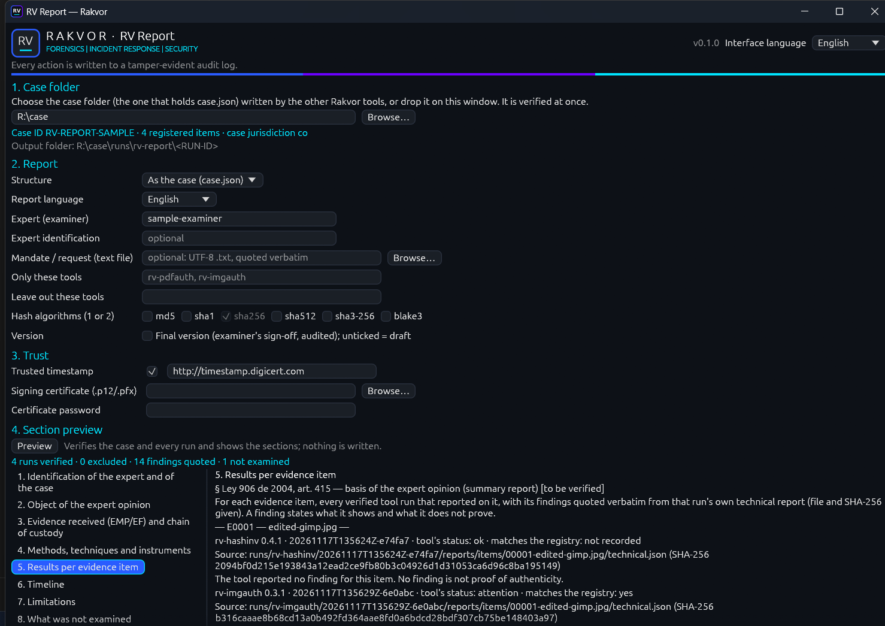
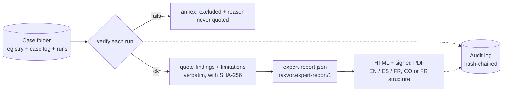

<p align="center"></p>

# RV Report

<!-- forge:description -->
**Expert report assembler.** Builds one dictamen pericial or rapport d'expertise from all the tools that ran on a case, with method, limits and custody filled in from the audit logs.
<!-- /forge:description -->

[](https://github.com/Panacota96/rv-report/actions/workflows/ci.yml)


RV Report reads a Rakvor case folder, **verifies every tool run before using it** (audit chain, completion,
case-log anchor, timestamp tokens, every recorded output re-hashed) and assembles one report for the court:
identification, evidence received with its custody, method per tool, results per item quoted **verbatim** from each
tool's own reports, the latest RV Timeline summary, limitations, what was not examined and annexes. A run that fails
verification is excluded with its reason and never quoted. The report is a **draft for the examiner's review** until
`--final`; it never writes a conclusion. Every legal reference it prints is marked "to be verified".





## Contents

- [What you get](#what-you-get) · [Install](#install) · [Quick start](#quick-start) · [Outputs](#outputs) ·
  [Exit codes](#exit-codes) · [Documentation](#documentation) · [Project layout](#project-layout) ·
  [Licence](#licence)

## What you get

| Part | What it does |
| --- | --- |
| `rv-report assemble` | the expert report of a case folder (CLI, full `--help`) |
| `rv-report-gui` | case folder picker, section preview (read-only), generate, open report |
| Structures | Colombia: *dictamen pericial* (Ley 906 de 2004); France: *rapport d'expertise* (CPP arts. 156–169) — both to be verified by counsel |
| Languages | report in EN, ES, FR (tools' wording never translated: shown marked `[EN]` when missing) |
| Trust | hash-chained audit log, RFC 3161 timestamp, PDFs signed with the examiner's certificate |
| Verification | `verify-log`, `verify-case`, independent Python verifier, JSON schema |

## Install

Portable zip or per-user installer from the releases ([docs/installation.md](docs/installation.md)), or from source:

```bash
cargo build --release --locked -p rv-report-cli -p rv-report-gui
# binaries: target/release/rv-report and target/release/rv-report-gui
```

## Quick start

```powershell
rv-report self-test
# Draft report of a case, in Spanish, with the mandate quoted
rv-report assemble --case-dir E:\CASE-014 --lang es --mandate E:\CASE-014\mandato.txt
# French structure, French + English
rv-report assemble --case-dir E:\CASE-014 --jurisdiction fr --lang fr,en --examiner-id "CA Paris 2026-117"
# After review: final, signed
rv-report assemble --case-dir E:\CASE-014 --lang es --final --sign-cert C:\certs\perito.p12
rv-report verify-case E:\CASE-014
```

Try it on the sample: `sh examples/sample/run.sh target/release/rv-report` (or `run.ps1` on Windows).

## Outputs

```text
<CASE>/runs/rv-report/<RUN-ID>/
  logs/      audit.jsonl  audit.log  hashes.csv (files read)  environment.json  timestamp-<SEQ>.tsr|.json
  reports/   expert-report.json  expert-report.<LANG>.html  expert-report.<LANG>.pdf
             statistics.json|.<LANG>.html|.pdf
             items/<NNNNN>-<NAME>/technical|summary|custody.*
```

## Exit codes

| Code | Meaning |
| :-: | --- |
| 0 | Report assembled; every run used verified, no medium/high signal |
| 1 | Runtime error (lock, output, certificate) |
| 2 | Usage error (options, mandate file, not a case folder, other case) |
| 3 | A run excluded or a medium/high signal; or the case fails verification (nothing written) |
| 130 | Cancelled |

## Documentation

| Page | For |
| --- | --- |
| [docs/usage.md](docs/usage.md) | From a case folder to a signed report; reading every section; troubleshooting |
| [docs/reports.md](docs/reports.md) | The report per section and per jurisdiction, signals, schemas |
| [docs/theory.md](docs/theory.md) | Plain-language part and expert part (verification, quoting, custody) |
| [docs/admissibility.md](docs/admissibility.md) | Draft legal mapping (Colombia, France/EU, ISO, US/UK), gaps, examiner checklist |
| [docs/case-folder.md](docs/case-folder.md) | What is read and written in the case folder, which runs are used |
| [docs/usage-cli.md](docs/usage-cli.md) | Every command and option (generated from `--help`) |
| [docs/usage-gui.md](docs/usage-gui.md) | The desktop app |
| [docs/architecture.md](docs/architecture.md) | Modules and one run step by step |
| [docs/forensic-audit.md](docs/forensic-audit.md) | Audit trail, actions, ISO/IEC 27037 mapping |
| [docs/installation.md](docs/installation.md) | Installing and verifying a release; building from source |
| [docs/development.md](docs/development.md) · [docs/release-process.md](docs/release-process.md) | Building, testing, releasing |
| [docs/adr/](docs/adr/0002-scope.md) | Decisions: [0001 language](docs/adr/0001-language.md), [0002 scope and assumptions](docs/adr/0002-scope.md) |

## Project layout

```text
rv-report/
├── src/core/      model.rs (frozen report model), sources.rs (verify runs), assemble.rs, report/expert.rs, run.rs
├── src/cli/       rv-report command line (clap); tests/cli.rs end-to-end on the sample case
├── src/gui/       rv-report-gui (egui); state.rs holds all testable rules
├── templates/     HTML templates + CSS (expert-report.html, statistics, technical, summary, custody)
├── i18n/          wording: en.json, es.json, fr.json
├── schemas/       JSON Schemas (expert-report, statistics, item reports, case, registry, describe)
├── examples/      sample case written by the released Rakvor tools + its synthetic evidence
├── tests/         Python verifier, schema and PDF-signature validators, sample-case builder
└── packaging/     Windows installer (Inno Setup)
```

## Contributing, security, licence

- How to contribute: [CONTRIBUTING.md](CONTRIBUTING.md) · Changes: [CHANGELOG.md](CHANGELOG.md)
- Report a vulnerability privately: [SECURITY.md](SECURITY.md)
- Licence: see [Licence](#licence). Third-party notices: [NOTICE](NOTICE).

## Licence

Source-available, non-commercial: [PolyForm Noncommercial 1.0.0](LICENSE). Anyone may use, study, change and share
RV Report for non-commercial purposes. Credit is required in every use: "RV Report by Rakvor", and keep the
`Required Notice:` line of [LICENSE](LICENSE). Commercial use (selling it, paid services, use in a for-profit
business's paid work) needs a written licence from Rakvor: see [COMMERCIAL.md](COMMERCIAL.md). Rakvor keeps all
commercial rights as the copyright owner. Rakvor's licensing texts ([COMMERCIAL.md](COMMERCIAL.md),
[NOTICE](NOTICE), this section) are drafts, to be verified by counsel (Colombia, France), and are not legal advice.
Third-party components keep their own licences: [NOTICE](NOTICE).
