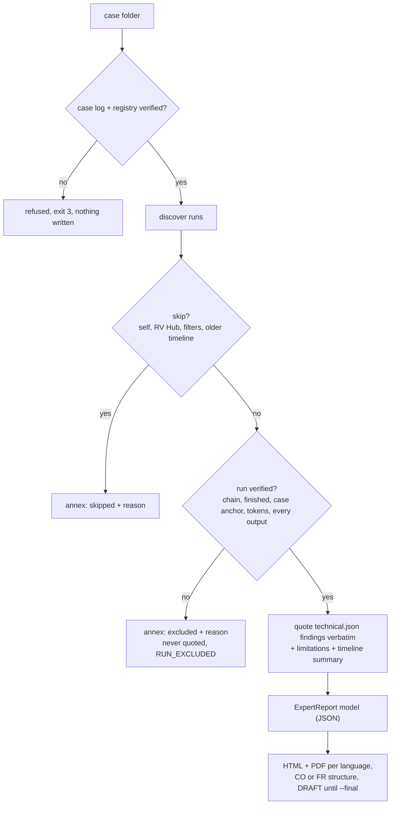

# ADR 0002 — Scope of RV Report v0.1: sources, verification, quoting, jurisdictions, draft/final

- **Status:** accepted (2026-11-17)
- **Deciders:** the project owner (intake in rv-hub#10, built by an agent at the owner's request). Every point
  below that the intake did not settle is an **assumption made by the building agent**, recorded here so that the
  owner and counsel can overturn it.
- **Scope:** `src/core/src/model.rs`, `sources.rs`, `assemble.rs`, `report/expert.rs`, `run.rs` (`run_assemble`),
  the CLI verb `assemble`, the GUI, `schemas/expert-report.schema.json`.

## Context

The intake (rv-hub#10): *"Expert report assembler. Builds one dictamen pericial (Colombia) or rapport d'expertise
(France) from all the tools that ran on a case, with method, limits and custody filled in from the audit logs."*
An expert report is read by a judge, by the parties and by an opposing expert. It is only defensible if every
sentence that describes a result can be traced to an audited tool output, if nothing a failed check produced is
ever quoted, and if the examiner — not the tool — stays the author who reviews and signs it.

## Decisions

### Sources and verification

1. **Tool outputs only.** RV Report never opens the evidence. It reads `case.json`, `case-log.jsonl`,
   `evidence/registry.json` and, for each run, `logs/audit.jsonl` and the reports the run recorded
   (`reports/statistics.json`, `reports/statistics.<lang>.html`, `reports/items/*/technical.json`).
2. **Verify the case, then every run, before reading.** The case log chain, the `case.json` digest and the
   registry digest must verify (else exit 3 and nothing is written — the suite's rule). A run is used only if: its
   folder is `runs/<tool>/<run-id>` inside the case; its audit chain is intact; it finished (`run_finished` in its
   audit log, not cancelled, and `run_finished` with status `completed` in the case log); the case log anchors its
   final audit entry (`audit_entries`/`audit_head`); the full `verify-log` check passes (timestamp tokens,
   truncation, **every** recorded output re-hashed by the shared `outputs.rs`); and the version the case log
   announces is the one its audit log recorded. Exclusion reasons: `unreadable`, `chain_broken`, `not_finished`,
   `digest_mismatch`, `timestamp_invalid`. Each file is checked again against its recorded digest when it is read.
3. **An excluded run is never quoted**, in no section: it appears only in the annex (with its reason and detail)
   and as one `RUN_EXCLUDED` signal (medium). Custody rows and "examined by" come from verified runs only.
4. **Skipped, not excluded:** this tool's own runs (`self`), RV Hub's verification runs (`verification`), runs
   left out by `--include-tool`/`--exclude-tool` (`tool_filter`) and RV Timeline runs older than the latest
   verified one (`superseded`). Skipped runs are listed in the annex and do not change the exit code.
5. **Unknown tools are not excluded.** A verified run of a tool RV Report has no description of (a future Rakvor
   tool) is quoted like the others when it wrote `rakvor.item-technical/1` reports; the method section then says
   that RV Report cannot describe that tool (`UNKNOWN_TOOL`, info). The descriptions of the known tools
   (`i18n/*.json` → `tools`) are RV Report's own summary of each tool's documentation and are labelled as such.
   The tools' `describe --json` only gives a role, so the role printed is the one the case log recorded.

### Quoting

6. **Wording comes from the tool's own report.** Each finding is quoted from the run's verified `technical.json`
   (`/findings/<n>`: code, severity, params, `text.<lang>.{title, shows, does_not_prove}`), with the file, its
   SHA-256 and the JSON pointer. RV Report never rewords, summarises or translates a finding.
7. **Missing language.** A tool writes finding text only in the languages its run used. When the report language
   is missing, the expert report shows the text in the first language the run has (en, es, fr), labelled with that
   language, and records `TRANSLATION_UNAVAILABLE` (info) once per run and language. Re-running the tool with that
   `--lang` is the fix; RV Report does not translate.
8. **Limitations.** Codes come from each run's `statistics.json`; their printed wording from the run's verified
   `statistics.<lang>.html` (the list after the localized heading *Limitations / Limitaciones / Limites*), paired by
   position only when the counts agree; otherwise the code is shown with a note. Runs of the same tool and version
   with the same limitations are listed once. RV Report adds its own limitations (`REPORT_*`).
9. **Timeline.** Only the latest verified RV Timeline run is used (older ones are skipped as `superseded`): its
   summary from its verified `statistics.json`, and its per-item signals quoted like any finding. If that run
   started before a quoted run finished, the report says so (`TIMELINE_PREDATES_RUNS`, low): the timeline may not
   include that run. No timeline run → `TIMELINE_ABSENT` (info).
10. **Signals, not verdicts.** RV Report's own signals are about the record, not the evidence: `RUN_EXCLUDED`
    (medium), `REGISTRY_MISMATCH_REPORTED` (high: a verified run recorded that the copy it examined differs from the
    registry), `ITEM_NOT_EXAMINED` (low), `TIMELINE_PREDATES_RUNS` (low), `UNKNOWN_TOOL`,
    `TRANSLATION_UNAVAILABLE`, `TIMELINE_ABSENT`, `JURISDICTION_DIFFERS_FROM_CASE` (info). Exit code 3 for any
    medium or high signal (so for any excluded run). The quoted findings keep the tools' severities and do **not**
    change RV Report's exit code: the tool that made them already reported them.
11. **What was not examined**: every registered item that no verified run of an *analysis* tool examined
    (rv-hashinv's intake, RV Hub, RV Timeline and RV Report do not examine content).

### Report structure and jurisdictions

12. **One report per run**: `reports/expert-report.json` (`rakvor.expert-report/1`, the frozen model in
    `model.rs`) plus `expert-report.<lang>.html` and `.pdf` for each `--lang`, recorded with `output_written`. The
    suite's standard outputs (statistics report, per-item technical/summary/custody reports) are written too, so
    the run is a normal Rakvor run for `verify-log`, `verify-case`, RV Hub and the validator.
13. **Jurisdiction**: `--jurisdiction co|fr` chooses the structure and legal references of the expert report;
    default = the case's jurisdiction (`case.json`). The per-item custody forms always follow the case (suite
    rule); a different `--jurisdiction` is recorded and noted (`JURISDICTION_DIFFERS_FROM_CASE`). Language and
    jurisdiction are independent (a Colombian structure can be printed in English for review).
14. **Colombia (CO)**: *dictamen pericial*, ordered on the elements the suite's admissibility notes map to Ley 906
    de 2004 arts. 413–415 and 417 (CGP art. 226 for civil matters): identification and qualifications of the
    expert, object, EMP/EF received and their custody, method/instruments/principles, results, limitations, what
    was not examined, annexes, declaration. **France (FR)**: *rapport d'expertise* (CPP arts. 156–169): mission,
    scellés received, description of the operations, findings per scellé, limits, what was not examined, annexes,
    conclusions and the art. 166 attestation. **Every legal reference the tool prints is marked "to be
    verified"**; the structure itself needs counsel's review in each jurisdiction (docs/admissibility.md, G-RP1).
15. **Language default `en`** (the suite's contract); a filing in Colombia or France needs `--lang es` or `--lang fr`.

### Examiner, mandate and sign-off

16. **The examiner is the author.** `--actor` (name) and optional `--examiner-id` (for example a professional card
    or expert-list registration — personal data the examiner supplies, printed and audited) identify the expert.
    `--mandate FILE` (alias `--request`) is a UTF-8 text file (at most 64 KiB, BOM ignored) with the object of the
    expertise; it is quoted verbatim, its SHA-256 audited (`mandate_read`) and listed in `hashes.csv`. Without it
    the report says that no mandate text was given.
17. **Draft until `--final`.** Every page carries "Draft for the examiner's review" until the examiner passes
    `--final`, which is audited (`report_marked_final`). `--final` does not sign: the PDF signature comes from
    `--sign-cert` (the examiner's certificate). RV Report never writes a conclusion on the merits: the
    conclusions/declaration section is a template with blank lines for the examiner.
18. **Time code.** New date/time code uses `jiff` (the suite is moving off chrono); strings keep the suite's
    RFC 3339 UTC formats.

## Alternatives considered

- *Re-describe findings in RV Report's own words (shorter, uniform):* rejected — two wordings of one finding invite
  disagreement and would make RV Report an unvalidated second analyst.
- *Machine-translate missing languages:* rejected — an unaudited translation of a forensic statement.
- *Quote excluded runs with a warning:* rejected (as in RV Timeline): a report mixing verified and unverified
  results cannot be relied on line by line.
- *Exit 3 for any quoted high finding:* rejected — the tool that made the finding already exits 3 for it; RV
  Report's exit code describes the assembly.
- *Write the conclusions automatically:* rejected — conclusions are the expert's opinion (CPP art. 166, Ley 906
  art. 415, to be verified); the tool assembles facts and their limits only.

## Consequences

- The report is **derived content**: its weight rests on each quoted tool's validation and on the examiner's review.
- A tool whose outputs do not follow `rakvor.item-technical/1` is listed in the method section but contributes no
  quoted findings (the report says so).
- Legal structure and citations are unverified until counsel reviews them (G-RP1 in docs/admissibility.md).
