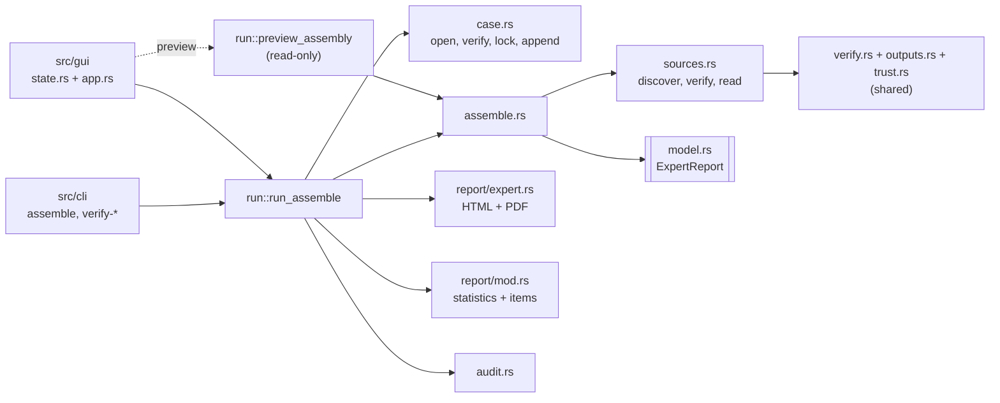
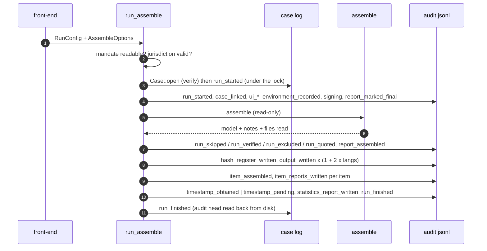
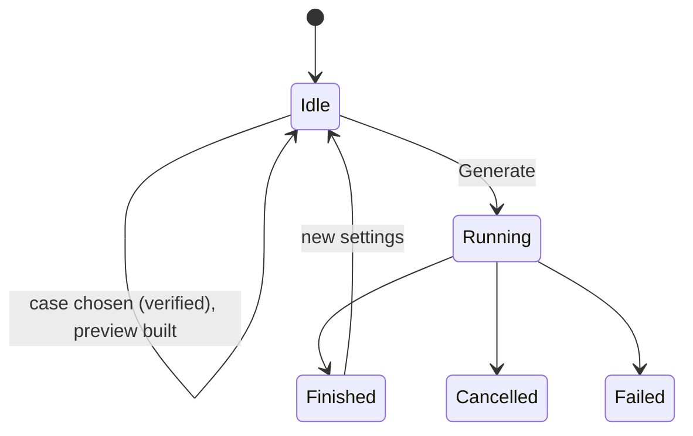

# Architecture

One core library that never prints; the CLI and the GUI are thin front-ends that build a `RunConfig` +
`AssembleOptions`, call the core and render its events.

## Modules

| File | Role | Shared with the suite |
| --- | --- | --- |
| `src/core/src/model.rs` | frozen data model of the report (`rakvor.expert-report/1`) | — |
| `src/core/src/sources.rs` | run discovery, verification, verified reads (adapted from RV Timeline) | pattern |
| `src/core/src/assemble.rs` | builds the model: skip/verify/quote, custody, method, limitations, timeline, not examined, signals | — |
| `src/core/src/report/expert.rs` | view model → HTML (minijinja) and PDF (built-in writer), per language | — |
| `src/core/src/run.rs` | `run_assemble` (pipeline, audit, case link), `preview_assembly`; template `run` kept for its tests | partly |
| `src/core/src/{audit,case,verify,i18n,events,env}.rs` | audit chain, case folder, verify-log, wording, events | yes |
| `src/core/src/{trust,outputs,hash,time}.rs`, `report/pdf.rs` | timestamps and signing, output re-hash, hashing, time, PDF writer | **byte-identical** across repos |
| `src/gui/src/state.rs` | every GUI rule, audited `ui_*` actions, preview sections | — |

## One run, step by step

## Run states (as the GUI sees them)

## Concurrency and cancellation

The GUI runs the core on a `std::thread` and receives events through an `mpsc` channel. The assembly is short (it
reads records, not evidence); Ctrl+C or Cancel is checked after the assembly: the run then records `run_cancelled`,
still writes the (partial) reports with the cancellation noted in the statistics report, and ends with
`run_finished {cancelled: true}` (exit 130).

## Why Rust

Same profile as the other Rakvor tools for one shared, audited core ([ADR 0001](adr/0001-language.md)).
