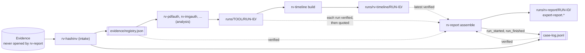
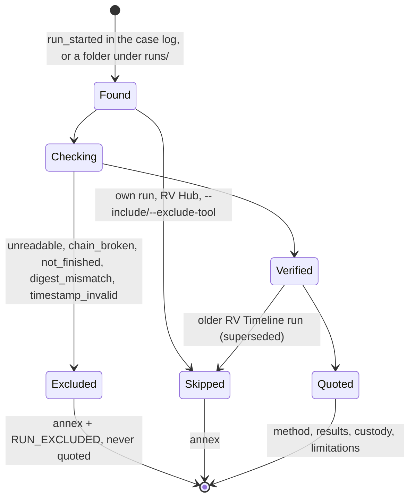
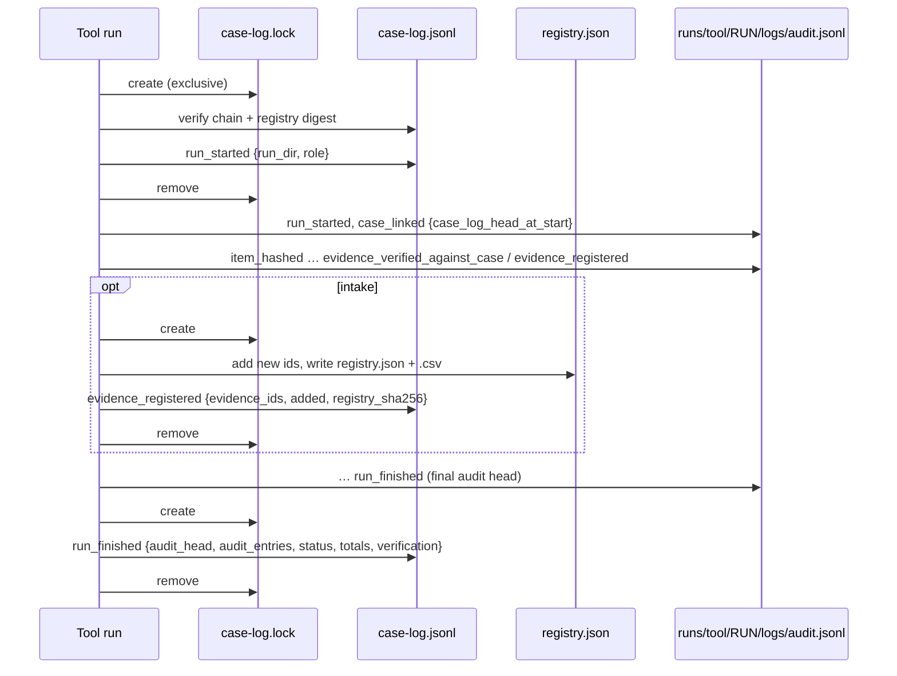
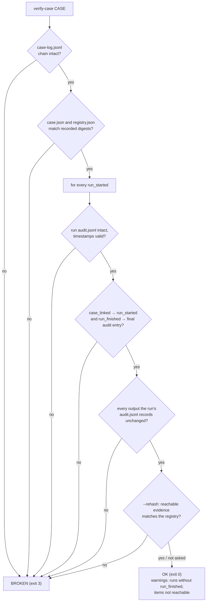

# Case folder

RV Report is an analysis-role tool of a special kind: its input is the case folder itself. It **reads** what the
other Rakvor tools recorded there — the case log, the evidence registry and every tool run — verifies each run before
using it, and writes **one** expert report in its own run folder, `runs/rv-report/<RUN-ID>/`. It never opens the
evidence and never writes the registry.



## Layout (`rakvor.case/1`)

```text
<CASE>/
  case.json                    case id, jurisdiction, creation (written once by the first tool)
  case-log.jsonl               hash-chained log of every run (run_started / run_finished, registrations)
  evidence/registry.json       E0001…: path, size, hashes, registered_by, registered_utc (+ registry.csv)
  runs/<tool>/<RUN-ID>/logs/     audit.jsonl, audit.log, hashes.csv, environment.json, timestamps
  runs/<tool>/<RUN-ID>/reports/  statistics.*, items/<NNNNN>-<NAME>/{technical,summary,custody}.*
  runs/rv-report/<RUN-ID>/reports/expert-report.json|.<LANG>.html|.<LANG>.pdf   this tool's report
```

JSON schemas: [case.schema.json](../schemas/case.schema.json), [registry.schema.json](../schemas/registry.schema.json),
[expert-report.schema.json](../schemas/expert-report.schema.json).

## What rv-report reads, and what it writes

| Path | Read (verified first) | Written |
| --- | --- | --- |
| `case.json` | case id, jurisdiction, creation; its SHA-256 against `case_created` | — |
| `case-log.jsonl` | chain; `run_started` / `run_finished` of every run (version, role, folder, status, `audit_entries`, `audit_head`, timestamp status); `evidence_registered` (custody rows) | `run_started` and `run_finished` of the assembly, under the lock |
| `evidence/registry.json` | its SHA-256 against the case log; every item (evidence received) | — |
| `runs/<tool>/<RUN-ID>/logs/audit.jsonl` | chain, `run_finished`, case-log anchor, timestamp tokens, the digest of every recorded output; items examined and their registry comparison | — |
| `runs/<tool>/<RUN-ID>/reports/` | `items/*/technical.json` (findings, quoted), `statistics.json` (limitation codes, RV Timeline's summary), `statistics.<lang>.html` (printed limitations) — each re-checked against its recorded digest when read | — |
| `runs/rv-report/<RUN-ID>/` | — | everything the assembly produces ([reports.md](reports.md)) |

`hashes.csv` of the assembly lists every file read (and the mandate file), with the run's algorithms. The case log
is left out: the assembly appends to it. The validator and `src/cli/tests/cli.rs` check that, after an assembly,
nothing in the case folder outside `runs/rv-report/` and `case-log.jsonl` changed.

## Using it

```bash
# 1. Intake and analyses with the other tools (same --case-dir), optionally a timeline
rv-hashinv scan -i D:\evidence -r --case-dir E:\CASE-014 --case CASE-014 --jurisdiction co
rv-pdfauth analyze -i D:\evidence\pdf --case-dir E:\CASE-014 --lang es
rv-timeline build --case-dir E:\CASE-014 --lang es
# 2. The draft expert report
rv-report assemble --case-dir E:\CASE-014 --lang es --mandate E:\CASE-014\mandato.txt
# 3. After review: the final, signed version, then check the whole case
rv-report assemble --case-dir E:\CASE-014 --lang es --final --sign-cert C:\certs\perito.p12
rv-report verify-case E:\CASE-014
```

Every assembly is a new run folder; earlier assemblies stay, and are never quoted (skipped as `self`).

## Which runs are used



| Check (in order) | Exclusion reason |
| --- | --- |
| folder is `runs/<tool>/<run>` and resolves inside the case; `logs/audit.jsonl` readable and non-empty | `unreadable` |
| audit chain intact | `chain_broken` |
| `run_finished` in the audit log, not cancelled | `not_finished` |
| case log intact, announces the run, `run_finished` with status `completed` | `chain_broken` / `not_finished` |
| entry `#audit_entries` of the audit log has the `audit_head` the case log recorded; only `timestamp_*` after it | `chain_broken` |
| the version in the case log is the one in the audit log | `unreadable` |
| `verify-log`: timestamp tokens, truncation, **every** recorded output re-hashed (`outputs.rs`) | `timestamp_invalid` / `digest_mismatch` / `chain_broken` |

A run of a tool RV Report does not know is verified the same way and quoted when it wrote `rakvor.item-technical/1`
reports (`UNKNOWN_TOOL`, info).

## Roles

The role is one constant: `CASE_ROLE` (`src/core/src/lib.rs`) and `"case_role"` in `.forge.json`: **analysis**.
`.forge.json` also declares `"input_mode": "case"` and `"sample_case": "examples/sample/case"`: the main verb reads a
whole case folder, so the evidence-input options (`--input`, `--recursive`, `--evidence`) do not exist. `--out` is
accepted for script compatibility and ignored. `--case ID`, when given, must match `case.json` (exit 2).

The forge template's per-item evidence pipeline (`run::run`, intake/analysis of evidence files) stays in the core
with its tests as the reference for the shared code; no front-end calls it.

## Events



| Case-log event | Written by | Details |
| --- | --- | --- |
| `case_created` | first tool | case_id, jurisdiction, schema, `case_json_sha256`, `registry_sha256: null` |
| `run_started` | every tool | tool, version, `run_dir` (relative), frontend, role, evidence_ids |
| `evidence_registered` | intake tool | evidence_ids (all of this run), added (new ones), registry_items, `registry_sha256` |
| `run_finished` | every tool, also after a cancel or a failure | status `completed`/`cancelled`/`failed`, `audit_head`, `audit_entries`, timestamp_status, totals, verification {registered, added, verified, mismatched, unregistered} |

Run audit (`audit.jsonl`) events added by the case folder: `case_linked` (entry #2, right after `run_started`),
`case_algorithm_added`, `evidence_registered`, `evidence_verified_against_case`, `evidence_not_in_case_registry`.

**The two chains vouch for each other.** `case_linked.case_log_head_at_start` is the hash of the run's
`run_started` entry in the case log; `run_finished.audit_head` in the case log is the hash of the run's final audit
entry. Editing either side breaks a link.

## Safety rules

- **A broken case is never extended.** Before every append a tool re-verifies the case-log chain, `case.json`
  (digest at creation) and the registry digest; on failure it stops with exit code 3 and writes nothing.
- **One writer at a time.** Appends happen under `case-log.lock` (created exclusively). A tool waits up to 30 s for
  another one; a lock older than 10 minutes is reported as *stale* with its owner, and is **never deleted
  automatically** — a person decides.
- **Only the intake tool writes the registry**, and every change records its new SHA-256 in the case log.
- **Reports name the evidence id** of each item; the custody form uses the case id, the evidence id and the intake
  date from the registry.

## How a reviewer verifies a case



1. `rv-report verify-case <CASE>` (any Rakvor tool has it; they agree). Exit 0 = intact, 3 = broken, 1 = not a
   case folder. Only `timestamp_obtained` may follow a run's recorded final entry (a delayed timestamp). Every
   output file a run's audit log records (reports, `hashes.csv`, `environment.json`) is re-hashed: an edited,
   deleted or replaced output is exit 3, named as `run <RUN-ID>: output reports/…`.
   `--rehash` also re-hashes every registered item still reachable at its registered path (the latest registration
   of a path) and compares it with the registry: a difference is exit 3, an unreachable item a warning.
   `rv-report verify-log <CASE>/runs/<tool>/<RUN-ID>/logs` checks one run and anchors its end to `run_finished` in
   the case log.
2. Independently of any Rakvor binary: `python tests/verify_chain.py <CASE>/runs/<tool>/<RUN-ID>/logs` re-checks a
   run (chain, hash register and every output its audit log records); the case log uses the same chain rule, and
   `sha256sum evidence/registry.json` must equal the last
   `registry_sha256` in `case-log.jsonl`.
3. Re-hash the evidence with any tool and compare it with `evidence/registry.csv` (or `verify-case --rehash`).
4. `python tests/validate_reports.py <CASE>` validates `case.json`, `registry.json` and every JSON report against
   `schemas/`.
