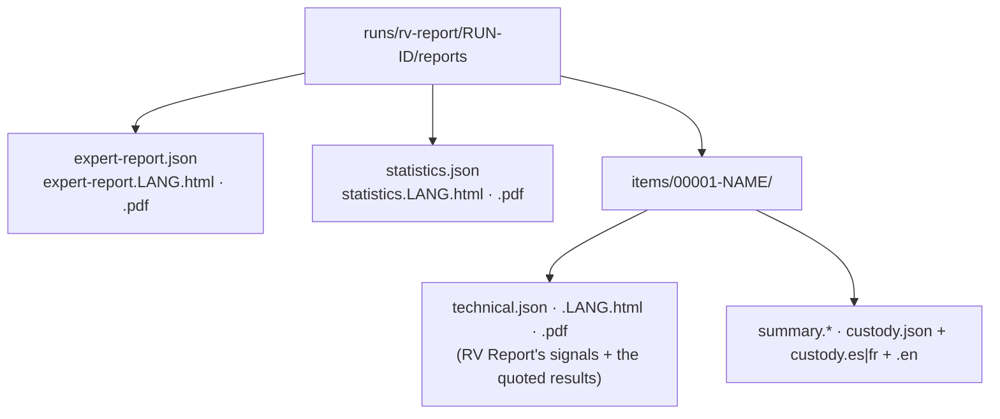
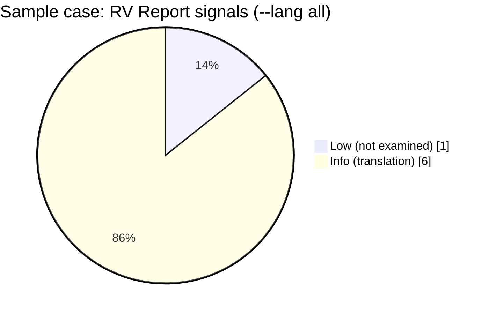

# Reports

An assembly writes **one expert report** — `expert-report.json` (language-neutral, schema
`rakvor.expert-report/1`) plus `expert-report.<lang>.html` and `.pdf` for each `--lang` — and the suite's standard
outputs: a statistics report and, per registered evidence item, a technical report, a customer summary and a
custody form. HTML and PDF are rendered from the same view model ([report/expert.rs](../src/core/src/report/expert.rs)
`expert_view`), so they never disagree; the GUI preview shows the same view.

## The expert report, section by section

| Section (CO / FR) | Content | Source |
| --- | --- | --- |
| Identification / Mission | case id, creation, `case.json` SHA-256, expert name and `--examiner-id`, run id, status (draft/final), structure, languages, tool filters; verification of the case (case-log entries and head, registry items and SHA-256) | case folder, options |
| Object (CO) / in Mission (FR) | the mandate quoted line by line, with file name, bytes, SHA-256 — or a note that none was given | `--mandate` |
| Evidence received (EMP/EF) / Scellés reçus | per item: id, file name, registered path, size, every registered digest, intake time, registering run; custody rows `#seq · time · action · tool version · run · actor · registry match` | registry, case log, verified runs |
| Methods / Description des opérations | RV Report's four steps; per tool: role (case log), what it does / checks (RV Report's summary; "unknown tool" otherwise), versions, runs, algorithms, languages, interface, items examined, findings quoted | runs' audit logs |
| Results / Constatations | per item, per verified run: tool, version, run, the tool's item status, registry match, source file + SHA-256, then every finding: severity, title, code, **what it shows**, **what it does not prove**, pointer; RV Report's item signals first | `technical.json` (verbatim) |
| Timeline / Chronologie | latest verified RV Timeline run: events, runs it read/excluded, zone-unknown events, display zone, signals by severity and code, sources | its `statistics.json` |
| Limitations / Limites | each tool version's printed limitations (runs listed), then RV Report's own | `statistics.json` + `.html` |
| Not examined | registered items no verified analysis run examined | registry vs runs |
| Annexes | totals; every run: status (verified / EXCLUDED / skipped), reason and detail, folder, start/end, audit head (entries), outputs verified N of M, timestamp status and token lines, findings quoted; RV Report's run-level signals | verification |
| Declaration / Conclusions et attestation | template text per jurisdiction, what the expert must add, draft/final note, signature lines | — (examiner) |

Every page starts with the **draft** banner (or the final banner after `--final`) and a disclaimer; each section
lists its legal basis with the mark *[to be verified]* / *[a verificar]* / *[à vérifier]*
([admissibility.md](admissibility.md#3b-the-reports-structure-per-jurisdiction-to-be-verified)).

### Per jurisdiction

| | Colombia (`co`) | France (`fr`) |
| --- | --- | --- |
| Title | Dictamen pericial — evidencia digital | Rapport d'expertise — preuve numérique |
| Sections | 10: identification, object, evidence, method, results, timeline, limitations, not examined, annexes, declaration | 9: mission (identification + object), evidence, method, results, timeline, limitations, not examined, annexes, declaration |
| References printed | Ley 906 de 2004 arts. 405–423, 413, 414, 415, 417, 254–266; Ley 1564 de 2012 art. 226 | CPP arts. 156, 157/160, 158, 163, 166, 167 |
| Default | `case.json` jurisdiction | `--jurisdiction fr` or a French case |

Language and structure are independent; the per-item custody forms always follow the case's jurisdiction.

### Language of quoted text

A tool writes finding text only in its run's `--lang`. Missing in the report language → the text is shown in the
first available language (en, es, fr), prefixed `[EN]`/`[ES]`/`[FR]`, and `TRANSLATION_UNAVAILABLE` is recorded.

## RV Report's signals (findings catalogue)

| Code | Severity | What it shows | What it does not prove |
| --- | --- | --- | --- |
| `RUN_EXCLUDED` | medium | a run failed verification; none of its results is quoted | that the evidence or the examiner did anything wrong |
| `REGISTRY_MISMATCH_REPORTED` | high | a verified run recorded that its copy differs from the registry | which copy is the original, or that anyone altered it |
| `ITEM_NOT_EXAMINED` | low | a registered item no analysis tool examined | that the item is suspicious |
| `TIMELINE_PREDATES_RUNS` | low | the timeline started before a quoted run finished | that the timeline is wrong |
| `UNKNOWN_TOOL` | info | RV Report cannot describe a verified tool | anything about that tool's reliability |
| `TRANSLATION_UNAVAILABLE` | info | a run's wording is missing in a report language | any change of result |
| `TIMELINE_ABSENT` | info | no verified RV Timeline run | that times are consistent or not |
| `JURISDICTION_DIFFERS_FROM_CASE` | info | the structure differs from the case's jurisdiction | a defect of the evidence |

Exit code 3 for any medium or high signal. Per-item technical reports carry the item's signals as findings
(status `problem` / `attention` / `ok`) and the quoted results (`quoted`).

## Limitations printed by RV Report

`REPORT_DERIVED_CONTENT`, `REPORT_QUOTES_ONLY_VERIFIED_RUNS`, `REPORT_NO_CONCLUSION`,
`REPORT_LEGAL_STRUCTURE_UNVERIFIED`, `REPORT_NO_TRANSLATION`, `CLEAN_RESULT_IS_NOT_AUTHENTICITY`,
`TIMESTAMP_PROVES_EXISTENCE_ONLY` (wording in [i18n/en.json](../i18n/en.json) `limitations`).

## JSON schemas

| File | Schema |
| --- | --- |
| `expert-report.json` | [expert-report.schema.json](../schemas/expert-report.schema.json) (strict: no unknown fields) |
| `statistics.json`, `technical.json`, `summary.json`, `custody.json` | the suite's schemas in [schemas/](../schemas/statistics.schema.json) |

`python tests/validate_reports.py <run>/reports` validates them. Keys are sorted; integers and strings only.

## PDF notes

Built-in writer (A4, Helvetica/Courier, WinAnsiEncoding: English, Spanish and French characters; others become
`?`). With `--sign-cert` every PDF, the expert report included, carries a detached CMS signature (checked in the
tests with pyHanko). HTML and JSON are not signed; their digests are in the audit chain, which is timestamped.
