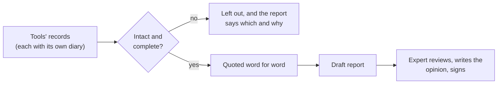
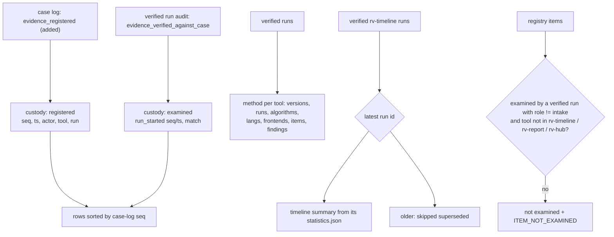
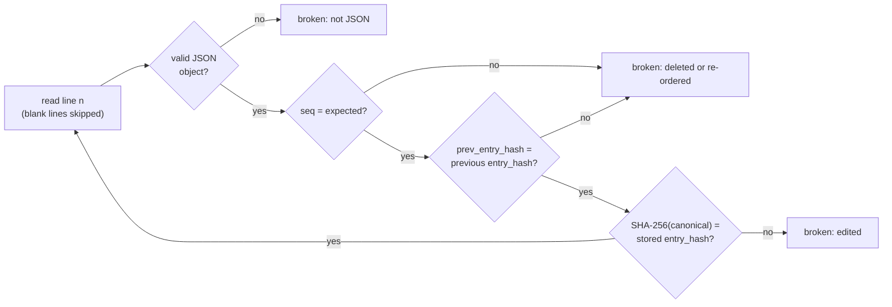
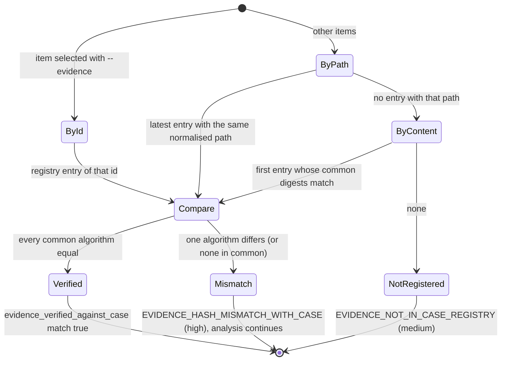
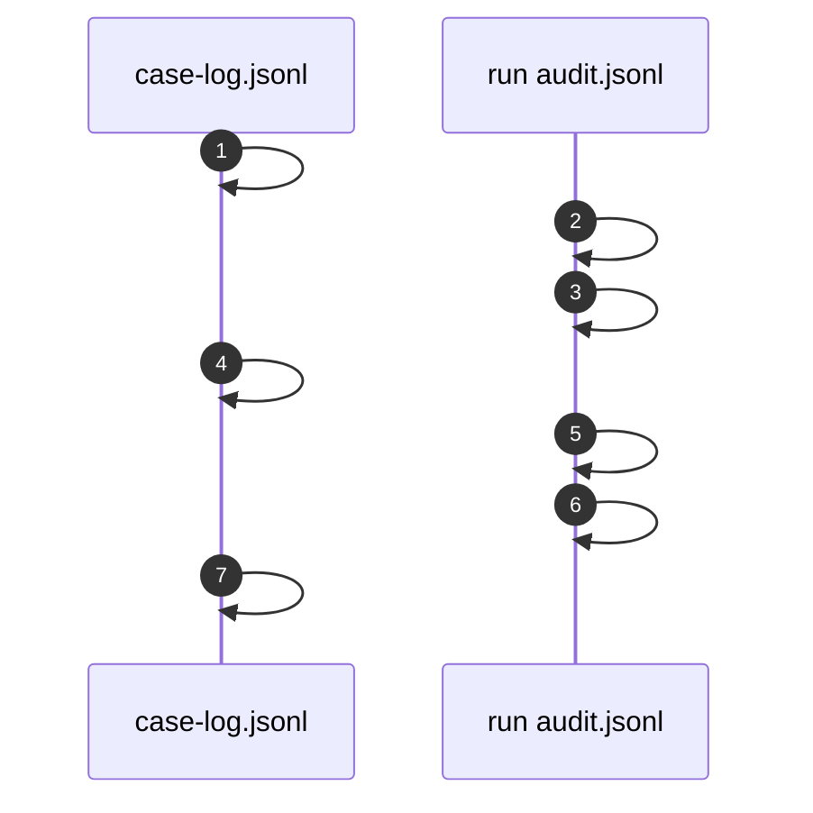
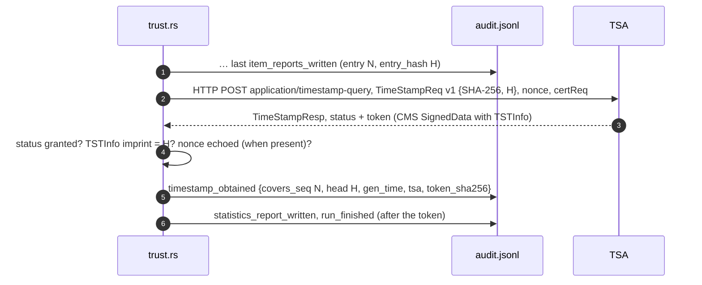
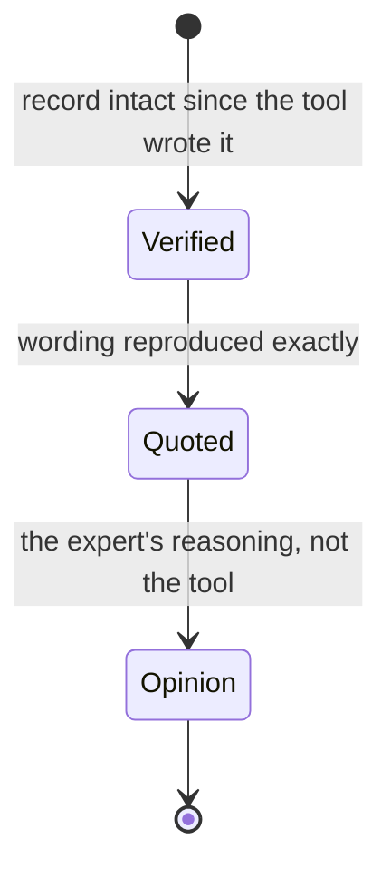

# Theory of operation

How RV Report turns the records of a Rakvor case folder into one expert report, written for two audiences:
**Part A** in plain language for clients, lawyers and judges; **Part B** for examiners and opposing experts, with
the rules taken from the code. Design decisions and their alternatives: [ADR 0002](adr/0002-scope.md).

## Contents

- [Part A — For clients, lawyers and judges](#part-a--for-clients-lawyers-and-judges)
- [Part B — For examiners and opposing experts](#part-b--for-examiners-and-opposing-experts)

# Part A — For clients, lawyers and judges

## A1 What the tool is (and is not)

A digital-forensic examination with the Rakvor tools produces many separate records: one tool registers the
evidence, others examine PDFs, images, e-mails, and each writes its own reports and its own tamper-evident diary
(the audit log). A court, however, receives **one** document from the expert: a *dictamen pericial* in Colombia, a
*rapport d'expertise* in France. RV Report assembles that document from the records.

| RV Report does | RV Report does not |
| --- | --- |
| check that every record it uses is intact and complete before using it | open or analyse the evidence itself |
| copy each tool's findings word for word, with where they come from | reword, summarise or translate a finding |
| list what each tool can and cannot show (its limitations) | decide whether a document is authentic |
| say which items no tool examined | write the expert's opinion or conclusions |
| mark the report as a draft until the expert approves it | sign for the expert (the expert's certificate does) |



## A2 Why "verify before quote"

Each tool keeps a diary in which every line is sealed to the one before it (a hash chain), and the case keeps a
diary of its own that records how each tool's diary ended. If anyone edits a tool's report after the fact, the
seal recorded for that report no longer matches; if anyone removes the last pages of a diary, the case diary
disagrees. RV Report checks all of this **before** it reads a record. A record that fails is not used at all — not
"used with a warning" — and the annex says which one and why. That way every sentence in the report rests on a
record that can be shown to be unchanged since the tool wrote it.

## A3 Word for word

A finding such as "the producer changes from X in revision 1 to Y in revision 2" is the examining tool's wording,
with "what it shows" and "what it does not prove". RV Report reproduces it exactly, and names the file and the
exact place it came from, so anyone can open that file and compare. If the tool wrote its findings only in English
and the report is in Spanish, the report shows the English text marked **[EN]** rather than inventing a
translation: a translation would be a new statement nobody has checked.

## A4 What was not examined

A report that only lists what was found can hide what was never looked at. RV Report lists every registered item
that no analysis tool examined (for instance a text file in a case about photos). Nothing is concluded about those
items — they are simply outside what the tools did.

## A5 A draft until the expert says otherwise

The law asks the expert, not the software, to state the method, the results and the conclusions and to sign
(the exact requirements are to be verified by counsel for each country). RV Report therefore prints "draft for the
examiner's review" on every page and leaves the conclusions and the declaration blank. Only when the expert runs it
again with `--final` (recorded in the diary) does the mark change, and only the expert's own certificate signs the
PDF.

## A6 What a clean report means

A report with no findings, no excluded runs and no signals means: the records verified and the tools found nothing
they look for. It does **not** mean the evidence is authentic. Every tool and RV Report itself print this
limitation.

# Part B — For examiners and opposing experts

## B1 Source map

| Concern | File |
| --- | --- |
| Frozen data model (`rakvor.expert-report/1`) | [model.rs](../src/core/src/model.rs), [schemas/expert-report.schema.json](../schemas/expert-report.schema.json) |
| Run discovery, verification, verified reads | [sources.rs](../src/core/src/sources.rs) (adapted from RV Timeline's `readers/mod.rs`) |
| Assembly (quoting, custody, method, limitations, timeline, not examined, signals) | [assemble.rs](../src/core/src/assemble.rs) |
| Rendering (one view model → HTML and PDF) | [report/expert.rs](../src/core/src/report/expert.rs), [templates/expert-report.html](../templates/expert-report.html) |
| Pipeline, audit, case link | [run.rs](../src/core/src/run.rs) `run_assemble`, `preview_assembly` |
| Wording EN/ES/FR | [i18n/](../i18n/en.json) `expert`, `tools`, `exclusion`, `skip`, `findings`, `limitations`, `ui` |

Constants: mandate at most 64 KiB (`MAX_MANDATE_BYTES`); known tools `KNOWN_TOOLS` (9); verification-only tools
`["rv-hub"]`; tools that do not examine content `["rv-timeline", "rv-report", "rv-hub"]`.

## B2 Run verification

```mermaid
sequenceDiagram
    autonumber
    participant A as assemble.rs
    participant S as sources.rs
    participant C as case-log.jsonl
    participant R as runs/TOOL/RUN
    A->>S: discover_runs (case log run_started, then folders under runs/)
    A->>A: skip? own tool (self), rv-hub (verification), filters (tool_filter)
    A->>S: verify_run
    S->>R: audit.jsonl: path safe, chain (seq, prev, entry_hash), run_finished not cancelled
    S->>C: chain; run_started for run_dir; run_finished status completed
    S->>R: entry #audit_entries has audit_head; only timestamp_* after it
    S->>R: verify-log: tokens, truncation, outputs.rs re-hashes every recorded output
    S-->>A: Verified {entries, head, outputs N of M, timestamps} or ReadError {reason}
    A->>R: RunData::json / text: each file re-checked against its recorded digest when read
```

Exclusion reasons, in the order they can arise: `unreadable` (folder not `runs/<tool>/<run>`, resolves outside the
case, missing or empty log, version disagreement), `chain_broken` (audit or case-log chain, head not anchored,
entries after the end), `not_finished` (no `run_finished`, cancelled, case log not `completed`), `digest_mismatch`
(any recorded output differs or is missing), `timestamp_invalid` (a token fails). Verification and reading are two
steps; a file changed between them fails the second digest check and the run is excluded as well.

## B3 Quoting

For each verified run, every recorded `reports/items/*/technical.json` whose `schema` starts with
`rakvor.item-technical/` is read. For each `findings[n]` the model keeps `code`, `severity`, `params` (strings),
`text.<lang>.{title, shows, does_not_prove}` exactly, the pointer `/findings/<n>`, and the source
`{file: runs/<tool>/<run>/reports/items/<folder>/technical.json, sha256}` (the SHA-256 recorded by the run's audit
log). The evidence id comes from `item.evidence_id`, else from the run's audit (`evidence_verified_against_case`,
`evidence_registered` for the item's index). `registry_match` is the run's own comparison.

Rendering in language *L*: `text[L]` if present, else the first of en, es, fr present, prefixed `[EN]`/`[ES]`/`[FR]`.
The end-to-end test compares every finding of every verified run with the model (JSON equality of `text`) and
checks that the English HTML contains each `title`, `shows` and `does_not_prove` string, HTML-escaped.

Limitations: codes from `reports/statistics.json` `limitations`; wording from `reports/statistics.<lang>.html`, the
`<li>` items of the `<ul>` right after `<h2>Limitations|Limitaciones|Limites</h2>`, HTML-unescaped, paired with the
codes **only if** the counts are equal. Blocks with the same tool, version and items are merged (runs listed).

## B4 Custody, method, timeline, not examined



`TIMELINE_PREDATES_RUNS`: the timeline run's `run_started` time (case log) is earlier than the `run_finished` time
of a quoted non-timeline run (both parsed with `jiff::Timestamp`).

## B5 RV Report's own signals

| Code | Severity | Condition |
| --- | --- | --- |
| `RUN_EXCLUDED` | medium | a run failed verification (one per run) |
| `REGISTRY_MISMATCH_REPORTED` | high | a verified run recorded `match: false` for an item it quoted |
| `ITEM_NOT_EXAMINED` | low | B4 |
| `TIMELINE_PREDATES_RUNS` | low | B4 |
| `UNKNOWN_TOOL` | info | a verified tool not in `KNOWN_TOOLS` |
| `TRANSLATION_UNAVAILABLE` | info | a run with wording lacks a report language (once per run and language) |
| `TIMELINE_ABSENT` | info | no verified RV Timeline run |
| `JURISDICTION_DIFFERS_FROM_CASE` | info | `--jurisdiction` differs from case.json |

Exit code 3 for any medium or high signal; the quoted findings' severities do not change it (ADR 0002 §10).
Severities are proposals, not measured.

## B6 The audit hash chain

Each line of `audit.jsonl` is one JSON object: `seq`, `ts_utc`, `run_id`, `actor`, `action`, optional `item`,
`details`, `prev_entry_hash`, `entry_hash` ([audit.rs](../src/core/src/audit.rs)). `audit.log` is a readable copy of
the same actions; it is not chained and not authoritative.

```text
canonical(e)      = JSON of e without "entry_hash"; keys sorted at every level; no whitespace; UTF-8,
                    non-ASCII not escaped; integers only
                    (Python: json.dumps(e, sort_keys=True, separators=(",", ":"), ensure_ascii=False))
entry_hash_n      = SHA-256( canonical(e_n) )                 hex, lower case
prev_entry_hash_1 = 64 × "0";   prev_entry_hash_n = entry_hash_(n-1);   seq_n = n
```

**Worked example** (computed for this page with the rule above; `rv-report verify-log` accepts these three lines):

```text
#1 canonical (287 bytes)
{"action":"run_started","actor":"Ana Ruiz","details":{"algorithms":["sha256","md5"],"tool":"rv-report",
"version":"0.1.0"},"prev_entry_hash":"0000000000000000000000000000000000000000000000000000000000000000",
"run_id":"20261021T152805Z-e8fd7a","seq":1,"ts_utc":"2026-10-21T15:28:05.817Z"}
   entry_hash = 6db9fbe2ebb025947fc663b32c09cab8d2ed072e7ae5d7ec3250671c34ee71c9

#2 canonical (245 bytes)
{"action":"inputs_resolved","actor":"Ana Ruiz","details":{"bytes":234,"items":3},
"prev_entry_hash":"6db9fbe2…34ee71c9","run_id":"20261021T152805Z-e8fd7a","seq":2,"ts_utc":"2026-10-21T15:28:05.819Z"}
   entry_hash = 4c78f96cb3e945d2705676d5bafa1942cad3146342a9fff9bf94e89f905754aa

#3 canonical (381 bytes)
{"action":"item_hashed","actor":"Ana Ruiz","details":{"bytes_read":61,"hashes":{"sha256":"80e089ad…183c3c"},
"index":2,"mtime_unchanged":true},"item":"D:\\ev\\acta.txt","prev_entry_hash":"4c78f96c…905754aa", …,"seq":3,…}
   entry_hash = 558b0ea25f29bcc8af1cbbcbbc191d1511ad8d040fffea1db6d1a79f76376223

#2 edited ("items":2) → f6a7e0fc0991175781ba340d8a338b11060c28db304e3e33bcf12f3e30a04264 ≠ stored
```

What `verify-log` prints for the three variants (real output):

```text
original           OK  3 entries, chain intact: ./audit.jsonl                                        exit 0
#2 edited          BROKEN  - line 2: entry_hash does not match its content (edited entry)            exit 3
#2 deleted         BROKEN  - line 2: sequence 3 where 2 was expected (deleted or re-ordered entry)
                           - line 2: prev_entry_hash does not link to the previous entry             exit 3
#3 removed (end)   OK  2 entries, chain intact                                                       exit 0
                       truncation not detectable without a timestamp or case record
```

The last variant is why `verify-log` also compares the end of the log with records kept outside it (next
paragraphs): on a standalone log with no timestamp it can only say so.



| Proves | Does not prove, on its own |
| --- | --- |
| No entry was edited, inserted, deleted or reordered **before the last entry present** | That entries were not removed **from the end**: a shorter chain is still valid (see the last line above). Only an anchor outside the log shows that |
| The order of work equals the order of entries | That the whole chain was not recomputed by someone who rewrote it from scratch |
| Report and output digests are bound to the run | When the entries were written (host clock, `ts_utc`) |

External anchors close those gaps: a complete run ends with `run_finished` (or `run_failed` / `run_cancelled`);
the case log records the run's final entry count and head ([B7](#b7-the-case-folder)); the RFC 3161 token binds
entry *N* ([B8](#b8-rfc-3161-trusted-timestamp)); the statistics report prints the head and entry count at the
time it was written; a signed PDF report binds that head to the examiner's key.

`verify-log` uses the first two automatically ([src/core/src/verify.rs](../src/core/src/verify.rs)):

| Anchor found | Check | Result line |
| --- | --- | --- |
| `timestamp-<K>.json` | entry `#K` exists and its hash is the token's imprint; every `timestamp_obtained` entry still has its token file | `truncation: entries up to #K are anchored by the RFC 3161 timestamp (…); n entries after it (…) cannot be proven complete` |
| run in `<CASE>/runs/<tool>/<RUN-ID>/logs` | `run_finished` in the case log: entry `#M` = `audit_entries` exists with hash `audit_head`; only `timestamp_obtained` after it | `truncation: the final entry #M is anchored by the case log (run_finished)` |
| neither | — | `truncation not detectable without a timestamp or case record` |

A log that ends before `#K` or `#M` is reported as `truncated: …` (exit 3). The highest anchor wins; when it is
the final entry, the log is complete as far as anything outside it can tell.

Independent check: [tests/verify_chain.py](../tests/verify_chain.py) re-implements the chain in Python (standard
library) and re-hashes the evidence listed in `hashes.csv` and every output the audit log records (it needs that file:
it is a run checker, not a case-log
checker). The append-only file is opened with `create_new` + `append`: an existing log is never overwritten; only
the `timestamp` command re-opens a log, after verifying it.

## B7 The case folder

Layout and contract: [case-folder.md](case-folder.md). This section explains why the design holds.

```text
<CASE>/case.json               {"schema":"rakvor.case/1","case_id","jurisdiction","created_utc","created_by":{…}}
<CASE>/case-log.jsonl          same chain rule as audit.jsonl; first entry case_created (carries case_json_sha256)
<CASE>/case-log.lock           exists only while a tool appends (created with create_new, removed on drop)
<CASE>/evidence/registry.json  {"schema":"rakvor.registry/1","items":[{evidence_id, path, size, hashes,
                               registered_by:{tool, version, run_id, audit_seq}, registered_utc}]}
<CASE>/evidence/registry.csv   evidence_id,path,size,<algorithms present>,run_id
<CASE>/runs/<tool>/<RUN-ID>/{logs,reports}/
```

Registry entry written by the suite's intake tool (rv-hashinv; path shortened):

```json
{
  "evidence_id": "E0003",
  "hashes": { "md5": "d0532b1672c85a82f561ad2de7e9a57a",
              "sha256": "42503ebb0f9892b30b72e11cfa0cbf5bcb5d60f667d611fa9598c9b4e835c643" },
  "path": "D:\\export\\foto-vacaciones.jpg",
  "registered_by": { "audit_seq": 12, "run_id": "20261021T152805Z-e8fd7a", "tool": "rv-report", "version": "0.1.0" },
  "registered_utc": "2026-10-21T15:28:05.909Z",
  "size": 112
}
```

`registered_by.audit_seq` = 12 points at the `item_hashed` entry of that run's `audit.jsonl` that holds the same
digests, so every registry row can be traced to a sealed log entry.

### Rules

| Rule | Code | Why |
| --- | --- | --- |
| A broken case is never extended | every append re-runs `verify_log_and_registry` under the lock: case-log chain, first entry `case_created`, `case.json` digest, registry digest = last `registry_sha256` in the log | a tool cannot silently build on an edited case |
| One writer at a time | `case-log.lock` created exclusively; wait ≤ 30 s; a lock older than 600 s is reported as stale and **never deleted automatically** | two tools never interleave entries |
| Only the intake role writes the registry | `register` (intake tool); RV Report and the analysis tools only read it | the reference values cannot drift |
| Paths are compared normalised | `normalize_path`: absolute, lexically normalised (`.`/`..` removed); `same_path`: case-insensitive on Windows (`to_lowercase`), exact elsewhere | the same file is found again by path; `D:\Evidence\a.pdf` = `d:\evidence\A.PDF` on Windows |
| A case run always shares an algorithm with the registry | `ensure_case_algorithm`: if the selection is disjoint from the algorithms present in **every** registered item, add SHA-256 (or the registry's first algorithm), replacing the second choice if two were selected; audited as `case_algorithm_added` | comparison is always possible |
| Evidence ids are never reused | next id = highest number + 1; same path **and** same content keeps its id | an id means one content forever |

### Matching an item against the registry (analysis role)



<!-- forge:domain -->
RV Report does not run this matching itself: it reads the result each verified analysis run recorded
(`evidence_verified_against_case`) and prints it in the custody rows and the results (`REGISTRY_MISMATCH_REPORTED`
when a run examined a copy that differs).
<!-- /forge:domain -->

### Cross-linking of the two chains



(Values from an intake by the suite's intake tool.) `verify-case` checks, for every `run_started` in the case log: the run's
`audit.jsonl` chain and timestamp tokens; that its `case_linked` names this case and quotes the `run_started` hash;
and that entry `audit_entries` of the run has hash `audit_head`, with only `timestamp_obtained` allowed after it.
It also warns about run folders the case log never announced. Editing either chain therefore breaks a link, and
truncating a finished run's audit log is detected here (and by `verify-log` on that run, which finds the case log
from the run folder's location, [B6](#b6-the-hash-chained-audit-log)).

With `--rehash`, `verify-case` also re-hashes the evidence: every registry entry whose path is still a file is
read once with the entry's own algorithms (at most two, standard order) and compared with the registry. A path
registered more than once (its content changed between intakes, so it received a new id) is compared with its
latest registration; the earlier ids are listed as superseded. A difference is a problem (exit 3); an unreachable
or unreadable file is a warning, because evidence copies often live on another workstation.

What `verify-case` does **not** do: validate the TSA certificate chain (it checks each token's TSA signature;
the chain needs `verify-log --tsa-ca`, B8), or prove that the registry's first content equals
the original source.

## B8 RFC 3161 trusted timestamp



The **message imprint is the chain head itself**: the 32 bytes of `entry_hash` of entry *N*, declared as a SHA-256
value. It is not hashed again, so `openssl ts -verify -digest <H>` works directly. Request layout (69 bytes; head
from the worked example of B6, example nonce):

```text
30 43                                   TimeStampReq SEQUENCE, 67 bytes
   02 01 01                             version v1
   30 31                                messageImprint
      30 0D 06 09 60 86 48 01 65 03 04 02 01 05 00     hashAlgorithm sha256 (2.16.840.1.101.3.4.2.1), NULL
      04 20 55 8B 0E A2 … 37 62 23      hashedMessage = entry_hash (32 bytes)
   02 08 1F 3A 5C 7E 9B 2D 4F 60        nonce (8 bytes, high bit cleared: positive INTEGER)
   01 01 FF                             certReq TRUE
```

- Nonce: first 8 bytes of SHA-256(clock, process id), high bit cleared. It detects a replayed response; it is not
  a secret.
- The response is limited to 1 MiB and 15 s. `TSTInfo` is read by a minimal DER walk because many TSAs write
  fractional seconds in `genTime`, which strict decoders reject; `gen_time` is stored to the second. Example: the
  test TSA's token said `15:30:01.367038`, the log says `2026-10-21T15:30:01Z`.
- Stored next to the log: `timestamp-<NNNNN>.tsr` (the DER **TimeStampResp**, not only the token) and
  `timestamp-<NNNNN>.json` (tsa, gen_time, covers_seq, head, token_sha256, file).
- Offline → `timestamp_pending` and the run completes; `rv-report timestamp <log>` later re-verifies the chain and
  appends `timestamp_obtained` for the then-current head (earlier entries are never rewritten).
- `verify-log` and `verify-case` re-check every token the audit log records (`timestamp_obtained`; a recorded token
  whose `.tsr` or `.json` is missing, or whose metadata disagrees with the entry, is a problem — deleting the
  metadata file does not skip the checks) and any token file next to the log that no entry records: that entry
  `covers_seq` is still in the log (otherwise: `truncated`), the `.tsr` SHA-256 against `token_sha256`, the TSA status, and that the imprint equals the `entry_hash` of
  `covers_seq`. They also verify the TSA's **CMS signature** (`trust::verify_token`, the same code as RV Hub,
  rv-pdfauth and rv-imgauth): the content type is `id-ct-TSTInfo`; there is exactly one SignerInfo and its
  certificate is in the token; the signed attributes carry content-type, a message-digest equal to the digest of
  the TSTInfo, and an ESS signing-certificate (v1 or v2) matching that certificate; the RSA PKCS#1 v1.5 signature
  over the signed attributes verifies; and the certificate's extended key usage is critical and contains only
  `id-kp-timeStamping` (RFC 3161 §2.3, as rv-certcheck and OpenSSL's `timestampsign` purpose). Any failure ("signature value does not verify") fails the log (exit 3).
- The **TSA certificate chain** is validated only by `verify-log --tsa-ca <CA bundle>` (PEM or DER): a path from
  the TSA certificate, through the certificates in the token, to one of the bundle's certificates, trying every
  candidate issuer and anchor (cross-signed intermediates, renewed anchors, self-issued key-rollover
  intermediates; at most 8 deep, no loops) and accepting a path only if (an RFC 5280 subset, `trust::check_path`):
  every RSA signature verifies and every certificate is valid at `genTime`; every intermediate has
  `cA=TRUE` (an anchor too, or is v1 / has keyCertSign); an issuer with keyUsage has `keyCertSign`; no
  `pathLenConstraint` is exceeded (self-issued certificates not counted); directoryName name constraints hold
  (other name forms are not evaluated: a path carrying such names under such a constraint is rejected); and no
  certificate has an unsupported critical extension (policyConstraints, policyMappings and inhibitAnyPolicy
  included: policy processing is not implemented, such chains fail closed). 34 fixture chains
  (`tests/fixtures/tsa-chains`) pin these rules, each cross-checked with `openssl verify -purpose timestampsign`. Without it the output says
  "chain not checked": the token is shown to be signed by the certificate it carries, not that this certificate
  belongs to a TSA you trust. **Revocation (CRL/OCSP), policy OID and accuracy are never checked**, and only RSA
  signers are supported (an ECDSA token fails as "signature not checked"). Revocation must be established
  separately, from CRL/OCSP evidence that covers `genTime`, before relying on the time in court (gap G18,
  [usage.md](usage.md#6-timestamps)). Independent signature/chain check of the test token (no revocation check:
  no CRL is supplied and OpenSSL does not query OCSP):
  `openssl ts -verify -digest 53b0de42…a91a61 -in timestamp-00018.tsr -CAfile ca.pem -untrusted tsa.pem` →
  `Verification: OK`.
- The default TSA URL is plain HTTP; integrity rests on the TSA's signature, which is why the OpenSSL check
  matters. eIDAS qualified status depends on the TSA chosen ([admissibility.md](admissibility.md)).

Standards: RFC 3161 (Time-Stamp Protocol), RFC 5816 (ESSCertIDv2 update), RFC 5652 (CMS).

## B9 Signed PDF reports

<!-- forge:domain -->
Reports are written by a small built-in PDF writer ([report/pdf.rs](../src/core/src/report/pdf.rs)): PDF 1.4,
A4, the standard Helvetica, Helvetica-Bold and Courier fonts with WinAnsiEncoding (English, Spanish and French
characters; anything else becomes `?`), no embedded fonts, one cross-reference table, one `%%EOF`.
<!-- /forge:domain -->

With `--sign-cert`, the file is written **once** with a signature placeholder and then signed in place (no
incremental update):

```text
technical.en.pdf of the sample (39 620 bytes), real values
… 9 0 obj << /Type /Sig /Filter /Adobe.PPKLite /SubFilter /adbe.pkcs7.detached
             /ByteRange [0 0000006359 0000039129 0000000491] /Contents <3082…000> /M (D:…) /Reason (…) >>
  widget /FT /Sig /T (RakvorExaminerSignature), invisible, on page 1;  catalog /AcroForm /SigFlags 3
0                  6359                                   39129              39620
├──── signed ──────┤<── /Contents: 32 770 bytes ─────────>├──── signed ──────┤
                     "<" + 32 768 hex digits + ">"  = room for 16 384 bytes of CMS (2 086 used here)
```

1. Write the whole PDF with `/ByteRange [0 0000000000 0000000000 0000000000]` and `/Contents <000…0>`, and keep
   the offset at which the signature dictionary object was written (the xref offset of `9 0 obj` above).
2. Locate both placeholders **inside that object only** — page text that happens to contain `/Contents <0000` or
   the byte-range marker is never touched (unit test `placeholder_bytes_in_page_text_are_left_alone`) — and fill
   the byte range with fixed-width (10-digit) numbers, so no offset moves.
3. Sign `file[0 .. 6359] ‖ file[39129 .. 39620]` ([trust.rs](../src/core/src/trust.rs) `PdfSigner`): CMS
   SignedData, detached, SHA-256, RSA PKCS #1 v1.5, signed attributes content-type, signing-time and
   message-digest, certificates from the `.p12`/`.pfx`. RSA keys only.
4. Write the DER as upper-case hex into the placeholder.

Independent check of the file above with pyHanko: `INTACT:UNTRUSTED,UNTOUCHED`, coverage `ENTIRE_FILE`, digest
SHA-256 (untrusted only because the test certificate has no trusted root). The trust test does the same on every
signed PDF of a run ([tests/validate_pdf_signature.py](../tests/validate_pdf_signature.py), through
`RV_TEST_PYTHON`): each must be intact and cryptographically valid; an untrusted chain is expected with the test CA.

This is a plain ISO 32000-1 CMS signature. It is not a PAdES baseline signature (ETSI EN 319 142-1: SubFilter
`ETSI.CAdES.detached` and a signing-certificate-v2 attribute), it carries no signature timestamp and no revocation
data. Its legal weight depends on the certificate ([admissibility.md](admissibility.md), gap G3). The certificate
subject and SHA-256 fingerprint are logged as `signing_certificate_loaded` and printed on every report (HTML, PDF,
and `run.pdf_signer_certificate_sha256` in the JSON); the password is never logged, and the interactive prompt does
not echo it.

## B10 Custody forms

One form per item, `custody.json` plus HTML and PDF in the jurisdiction's language and in English
([report/mod.rs](../src/core/src/report/mod.rs) `custody_*`, [templates/custody.html](../templates/custody.html),
[schemas/item-custody.schema.json](../schemas/item-custody.schema.json)).

| Field | Colombia (`co`, Spanish) | France (`fr`, French) | Filled from |
| --- | --- | --- | --- |
| Title and legal basis | Ley 906 de 2004 arts. 254–266, Fiscalía manual, Ley 527 de 1999 | CPP arts. 156 ff.; seal number refers to the judicial *scellé* | i18n catalogue |
| Case | Case number (NUNC) | Case / procedure reference | `case_id` |
| Item code | Evidence item (EMP/EF) code | Seal number | evidence id `E0001…` in a case folder, else `<RUN-ID>-<NNNNN>` |
| Registered at intake | date and time (UTC) | same | registry `registered_utc` (case folder only) |
| Description, location | file name · size · detected type; path of the examined copy | same | the run |
| Integrity values | every digest of the run | same | `item_hashed` |
| Operations | tool, version, run id, start and end (UTC), audit entries `#first–#last` | same | the run |
| Transfers | 6 blank rows: date and time, delivered by, received by (name, ID, signature), purpose, condition of packaging / media | same | to sign by hand |
| Signatures | examiner, receiver | same | to sign by hand |

`custody.json` lists `transfers: []`: the tool never invents a transfer; the physical chain is completed by
people. The form is a working aid, not the official Fiscalía *Registro de Cadena de Custodia* or a French
*scellé* record ([admissibility.md](admissibility.md#consolidated-gap-list), G9).

## B11 Determinism and repeatability

Given the same case folder and options, the model is the same except for the clock (`run.run_id`,
`run.generated_utc`): runs are sorted by (tool, run id), items by the registry, findings by source path then
position, custody rows by case-log sequence, maps by key (serde_json without `preserve_order`). The JSON is written
pretty with sorted keys, so two assemblies of the same case differ only in those fields. The report reproduces the
tools' wording, so a re-run of a tool with another `--lang` changes the report only through that run.

## B12 What RV Report does not prove



- A verified run shows the **record** is intact since the tool wrote it, not that the tool's analysis is right.
- An excluded run shows its record cannot be relied on as written, not that the evidence or the examiner did
  anything wrong.
- A quoted finding proves what the quoting tool says it proves and no more ("does not prove" is printed with it).
- An item listed as not examined is not suspicious; one with no findings is not authentic for that reason.
- The legal structure and references are drafts to be verified by counsel.
