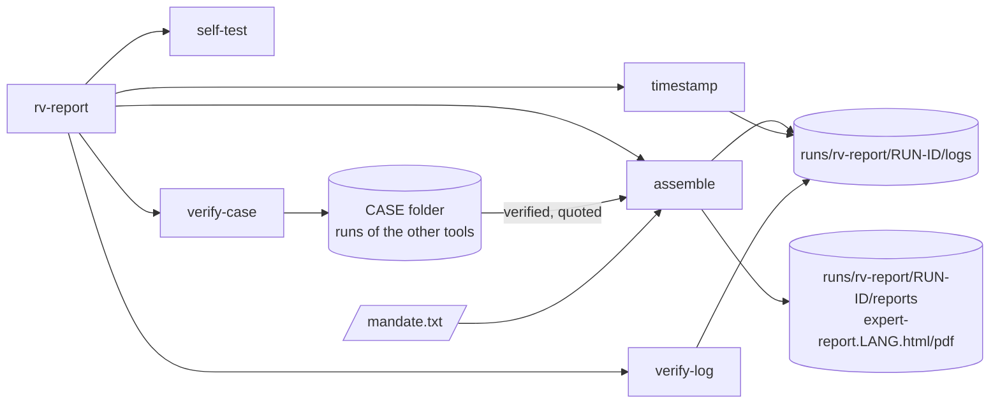

# Command-line reference

<!-- Generated by `rv-report docs-cli`. Do not edit by hand: CI fails if this file differs. -->



## rv-report

```text
DESCRIPTION:
  rv-report reads a Rakvor case folder (the folder that holds case.json) and assembles ONE expert
  report from every tool that ran on the case: a dictamen pericial structured for Colombia
  (Ley 906 de 2004) or a rapport d'expertise structured for France (CPP arts. 156-169). It never
  opens the evidence itself. For the case it:
    1. verifies the case log, case.json and the evidence registry (a broken case is refused,
       exit 3, and nothing is written to it);
    2. verifies every tool run before using it: audit chain intact, run finished and anchored in
       the case log, timestamp tokens, and every output re-hashed against the digest its audit
       log recorded. A run that fails is excluded with the reason and NEVER quoted;
    3. quotes each verified run's findings verbatim from its own technical reports (code,
       severity, title, what it shows, what it does not prove) and its printed limitations,
       and embeds the latest verified RV Timeline summary;
    4. fills in identification (case, examiner, mandate), evidence received with its custody
       rows from the case log, method per tool, results per evidence item, timeline,
       limitations, what was not examined, annexes (every run with its audit head, timestamp
       status and outputs verified) and the examiner's declaration template;
    5. writes reports/expert-report.json and expert-report.<LANG>.html/.pdf (PDF signed with
       --sign-cert), plus the suite's statistics and per-item reports.
  The report says "draft for the examiner's review" on every page until the examiner gives
  --final (audited). The run is written inside the case, under <CASE>/runs/rv-report/<RUN-ID>/,
  and recorded in the case log. Every action is appended to a hash-chained log that
  `rv-report verify-log` can check later; `rv-report verify-case <CASE>` checks the whole case.

Usage: rv-report <COMMAND>

Commands:
  assemble     Assemble the expert report of a case folder from the verified runs of the other
               Rakvor tools
  verify-log   Verify an audit log (audit.jsonl): edited, deleted or re-ordered entries, and
               truncation
  self-test    Check every hash algorithm against known-answer test vectors
  timestamp    Add an RFC 3161 timestamp to a finished run (e.g. after working offline)
  verify-case  Verify a whole case folder: case log, evidence registry and every run's audit log
  help         Print this message or the help of the given subcommand(s)

Options:
  -h, --help
          Print help (see a summary with '-h')

  -V, --version
          Print version

Run `rv-report <COMMAND> --help` for the options, examples and exit codes of each command.
```

## rv-report assemble

```text
DESCRIPTION:
  rv-report reads a Rakvor case folder (the folder that holds case.json) and assembles ONE expert
  report from every tool that ran on the case: a dictamen pericial structured for Colombia
  (Ley 906 de 2004) or a rapport d'expertise structured for France (CPP arts. 156-169). It never
  opens the evidence itself. For the case it:
    1. verifies the case log, case.json and the evidence registry (a broken case is refused,
       exit 3, and nothing is written to it);
    2. verifies every tool run before using it: audit chain intact, run finished and anchored in
       the case log, timestamp tokens, and every output re-hashed against the digest its audit
       log recorded. A run that fails is excluded with the reason and NEVER quoted;
    3. quotes each verified run's findings verbatim from its own technical reports (code,
       severity, title, what it shows, what it does not prove) and its printed limitations,
       and embeds the latest verified RV Timeline summary;
    4. fills in identification (case, examiner, mandate), evidence received with its custody
       rows from the case log, method per tool, results per evidence item, timeline,
       limitations, what was not examined, annexes (every run with its audit head, timestamp
       status and outputs verified) and the examiner's declaration template;
    5. writes reports/expert-report.json and expert-report.<LANG>.html/.pdf (PDF signed with
       --sign-cert), plus the suite's statistics and per-item reports.
  The report says "draft for the examiner's review" on every page until the examiner gives
  --final (audited). The run is written inside the case, under <CASE>/runs/rv-report/<RUN-ID>/,
  and recorded in the case log. Every action is appended to a hash-chained log that
  `rv-report verify-log` can check later; `rv-report verify-case <CASE>` checks the whole case.

Usage: rv-report assemble [OPTIONS] --case-dir <DIR>

Options:
      --case-dir <DIR>
          The case folder to read (the one that holds case.json), written by the other Rakvor tools.
          The report run is written inside it, under <DIR>/runs/rv-report/<RUN-ID>/.
          Default: none (required)
          Example: --case-dir E:\CASE-014

  -j, --jurisdiction <CC>
          Structure and legal references of the report: co (dictamen pericial, Colombia) or fr
          (rapport d'expertise, France). The per-item custody forms always follow the case's own
          jurisdiction (case.json); a different value here is recorded and noted in the report.
          Default: the case's jurisdiction (case.json)
          Example: --jurisdiction fr

  -l, --lang <LANG>
          Report language(s): en, es, fr (comma-separated), or all. A filing needs the language of
          the court (es for Colombia, fr for France). JSON is language-neutral.
          Default: en
          Example: --lang es   or   --lang all

  -a, --actor <NAME>
          Name of the examiner (the expert who reviews and signs), written in every audit entry and
          in the report (alias: --examiner).
          Default: the operating-system user name
          Example: --actor "Ana Ruiz"

      --examiner-id <TEXT>
          The expert's identification as it must appear in the report (professional card, expert
          list registration, ...). Personal data: printed in the report and the audit log.
          Default: none (the report says it was not given)
          Example: --examiner-id "TP 12345-CO"

      --mandate <FILE>
          UTF-8 text file with the object of the expertise (the order, request or questions), quoted
          verbatim in the report; its SHA-256 is audited. At most 64 KiB (alias: --request).
          Default: none (the report asks the examiner to state the object)
          Example: --mandate E:\CASE-014\mandato.txt

      --include-tool <TOOL>
          Only the runs of these tools, comma-separated or repeated (e.g. rv-pdfauth, rv-imgauth,
          rv-timeline). Other runs are skipped and listed in the annexes.
          Default: every tool
          Example: --include-tool rv-pdfauth,rv-imgauth

      --exclude-tool <TOOL>
          Leave out the runs of these tools (comma-separated or repeated); listed as skipped.
          Default: none
          Example: --exclude-tool rv-rsmf

      --final
          Mark the report as the examiner's final version (audited as report_marked_final). Without
          it every page says "draft for the examiner's review". It does not sign: use --sign-cert.
          Default: off (draft)
          Example: --final

  -H, --hash <ALGO>
          Hash algorithm(s) for the files this run reads and writes (hashes.csv, reports, logs): one
          or two of md5, sha1, sha256, sha512, sha3-256, blake3. More than two is refused (exit 2).
          Default: sha256
          Example: --hash sha256,md5

  -o, --out <DIR>
          Not used by assemble: every output goes inside the case folder (<CASE>/runs/rv-report/).
          Accepted so that scripts shared with the other Rakvor tools keep working.
          Default: ./rakvor-out (ignored)
          Example: --out E:\case-014\rv-report

  -c, --case <ID>
          Case identifier: when given, it must match the case folder's case.json (exit 2 otherwise).
          Default: none (the case id is read from case.json)
          Example: --case CASE-2026-014

  -p, --progress <MODE>
          How progress is shown: bar, jsonl or none.
          Default: bar (hidden automatically when stderr is not a terminal)
          Example: --progress jsonl

          Possible values:
          - bar:   Progress bar with elapsed time and the runs done on stderr
          - jsonl: One JSON event per line on stdout (for scripts and other tools)
          - none:  No progress output; only the final summary

      --tsa-url <URL>
          RFC 3161 time-stamping authority for the audit chain head.
          Default: http://timestamp.digicert.com
          Example: --tsa-url https://freetsa.org/tsr

      --no-timestamp
          Do not request a trusted timestamp (offline labs). Also set by RV_NO_TIMESTAMP=1.
          Default: off (a timestamp is requested)
          Example: --no-timestamp

      --sign-cert <P12>
          Examiner's certificate (.p12/.pfx, RSA) used to sign every PDF (the expert report and the
          item reports). The password is read from the environment variable named by
          --sign-pass-env, or asked for interactively.
          Default: none (PDFs are not signed)
          Example: --sign-cert C:\certs\ana-ruiz.p12

      --sign-pass-env <VAR>
          Environment variable holding the certificate password.
          Default: RV_SIGN_PASSWORD
          Example: --sign-pass-env CERT_PASS

  -h, --help
          Print help (see a summary with '-h')

EXAMPLES:
  Draft report of a case, structure and language of the case (Colombia -> use Spanish):
    rv-report assemble --case-dir E:\CASE-014 --lang es
  French structure, French and English, with the examiner's id and the mandate text:
    rv-report assemble --case-dir E:\CASE-014 --jurisdiction fr --lang fr,en \
      --actor "Ana Ruiz" --examiner-id "CA Paris 2026-117" --mandate E:\CASE-014\mandat.txt
  Only the PDF and image analyses, two hashes, machine-readable progress:
    rv-report assemble --case-dir E:\CASE-014 --include-tool rv-pdfauth,rv-imgauth \
      --hash sha256,md5 --progress jsonl
  After review, the final version signed with the examiner's certificate:
    rv-report assemble --case-dir E:\CASE-014 --lang es --final --sign-cert C:\certs\perito.p12
  Then verify the run's audit log and the whole case:
    rv-report verify-log E:\CASE-014\runs\rv-report\<RUN-ID>\logs
    rv-report verify-case E:\CASE-014

EXIT CODES:
  0    Report assembled; every run used verified and no medium- or high-severity signal.
  1    Runtime error (case log locked by another tool, output not writable, signing
       certificate unreadable or wrong password, ...). See the audit log.
  2    Usage error (unknown option, more than two hash algorithms, unsupported language,
       unknown tool in --include-tool/--exclude-tool, mandate file missing, not UTF-8 or larger
       than 64 KiB, a folder that is not a case folder, --case of another case).
  3    Report assembled with at least one run excluded (not verified: chain broken, digest
       mismatch, not finished, timestamp invalid, unreadable) or a medium/high signal (e.g. a
       tool examined a copy that differs from the registry); or the case folder fails
       verification (nothing is written to it).
  130  Cancelled with Ctrl+C. The cancellation is written to the audit log.

FILES WRITTEN:
  Inside the case folder, <RUN> = <CASE>/runs/rv-report/<RUN-ID>:
  <RUN>/logs/audit.jsonl              Hash-chained log of every action: runs skipped, verified,
                                      excluded (with the reason) and quoted (with each source's
                                      SHA-256), the mandate's digest, report_marked_final, outputs.
  <RUN>/logs/audit.log                The same actions, human-readable.
  <RUN>/logs/environment.json         Tool and dependency versions, OS, host, user, command line.
  <RUN>/logs/hashes.csv               Every file whose content entered the report (case.json,
                                      registry, each verified run's audit log and reports read,
                                      the mandate), with the run's hash algorithms.
  <RUN>/logs/timestamp-<SEQ>.tsr|.json  RFC 3161 token for the audit chain head.
  <RUN>/reports/expert-report.json    The report model (schema rakvor.expert-report/1).
  <RUN>/reports/expert-report.<LANG>.html|.pdf  The report in each language (PDF signed with
                                      --sign-cert). Digests in the audit log (output_written).
  <RUN>/reports/statistics.json       Signals, items and run summary (+ .<LANG>.html and .pdf).
  <RUN>/reports/items/<NNNNN>-<NAME>/technical|summary|custody.*  Per registered item: RV
                                      Report's signals, the quoted results, the custody form.
  <CASE>/case-log.jsonl               run_started and run_finished of this run are appended.
  Nothing else in the case folder changes: the other tools' runs and the evidence are only read.

FORENSIC NOTES:
  - Verification comes before reading: a run whose audit chain is broken, that did not finish,
    whose timestamp token fails or whose output differs from the digest in its own audit log is
    excluded and never quoted. The exclusion is in the audit log, the annexes and a RUN_EXCLUDED
    signal.
  - Findings are quoted verbatim from each tool's own report, with the file, its SHA-256 and the
    JSON pointer. RV Report never rewords or translates them: when a tool wrote no text in the
    report language, the text is shown in its own language, marked [EN]/[ES]/[FR].
  - Results are signals, not verdicts: every finding says what it does not prove, and an item
    without findings is not proven authentic. Items no analysis tool examined are listed.
  - RV Report writes no conclusion: the examiner reviews the draft, writes the opinion and
    signs. --final only marks the version (audited); the signature is --sign-cert's.
  - Every legal reference in the report is marked "to be verified"; the structure is a draft
    for counsel's review (docs/admissibility.md).
  - Each audit entry stores the SHA-256 of the previous one; the run's audit head is recorded in
    the case log. The chain head is timestamped by an RFC 3161 authority; offline, the run
    finishes with `timestamp_pending`: run `rv-report timestamp <LOG>` later.
  - With --sign-cert every PDF is signed with the examiner's certificate; the password is never
    logged.
```

## rv-report verify-log

```text
Verify an audit log (audit.jsonl): edited, deleted or re-ordered entries, and truncation

Usage: rv-report verify-log [OPTIONS] <LOG>

Arguments:
  <LOG>
          Path to audit.jsonl, or to the run's log folder that contains it.
          
          Example: E:\CASE-014\runs\rv-report\20261019T101500Z-a1b2c3\logs

Options:
      --tsa-ca <PEM>
          CA bundle (PEM with one or more certificates, or one DER certificate) that the TSA
          certificate of every timestamp token must chain to, at the token's genTime.
          
          Default: none (the TSA signature is checked, the chain is not).
          Example: --tsa-ca C:\certs\tsa-roots.pem

  -h, --help
          Print help (see a summary with '-h')

CHECKS:
  - every entry links to the previous one (hash chain): an edited, deleted or re-ordered entry
    breaks it;
  - every timestamp token the log records (timestamp_obtained) is still next to it with its
    metadata (timestamp-<SEQ>.tsr with the recorded SHA-256, timestamp-<SEQ>.json agreeing): a
    missing file is a problem, never a skipped check. Every token covers the hash of the entry
    it names;
  - the TSA's CMS signature of every token: signer certificate in the token, ESS
    signing-certificate binding, message digest over TSTInfo, RSA signature, and an extended key
    usage that is critical and only timeStamping (RFC 3161). With --tsa-ca, also the TSA
    certificate path up to that CA bundle at the token's genTime; without it the output says
    "chain not checked". Revocation is never checked;
  - truncation: a chain alone cannot show that entries were removed from its end. The log must
    still contain the entry covered by its RFC 3161 timestamp (covers_seq) and, for a run inside
    a case folder (<CASE>/runs/<TOOL>/<RUN-ID>/logs), end with the audit head that the case log
    recorded at run_finished (only timestamp_obtained may follow). With neither record the
    output says "truncation not detectable without a timestamp or case record";
  - recorded outputs: every file the log says the run wrote (expert report, item reports,
    statistics, hashes.csv, environment.json) is re-hashed with each algorithm recorded and
    compared; the latest entry for a file wins. A missing, edited or replaced file is a
    problem; a recorded path that is absolute, contains .. or resolves outside the run folder
    is rejected and not read. Output: "outputs: N verified of M recorded (algorithms)".

EXAMPLES:
  rv-report verify-log rakvor-out/logs/20261019T101500Z-a1b2c3/audit.jsonl
  rv-report verify-log E:\CASE-014\runs\rv-report\20261019T101500Z-a1b2c3\logs
  rv-report verify-log E:\CASE-014\runs\rv-report\20261019T101500Z-a1b2c3\logs --tsa-ca roots.pem

EXIT CODES:
  0  The chain is intact and agrees with its timestamps and case record (if any), and every
     output file it records still has the recorded digests.
  1  The log or the --tsa-ca file cannot be read.
  3  The chain is broken, a timestamp does not match or does not verify, the log is shorter
     than its timestamp or case record says (truncated), or a recorded output file was edited,
     deleted or replaced after the run.
```

## rv-report self-test

```text
Check every hash algorithm against known-answer test vectors

Usage: rv-report self-test

Options:
  -h, --help
          Print help (see a summary with '-h')

EXAMPLES:
  rv-report self-test

EXIT CODES:
  0  All algorithms give the published answer for the input "abc".
  1  At least one algorithm failed: do not use this build for evidence.
```

## rv-report timestamp

```text
Add an RFC 3161 timestamp to a finished run (e.g. after working offline)

Usage: rv-report timestamp [OPTIONS] <LOG>

Arguments:
  <LOG>
          The run's log folder (or its audit.jsonl).
          
          Example: E:\CASE-014\runs\rv-report\20261019T101500Z-a1b2c3\logs

Options:
      --tsa-url <URL>
          RFC 3161 time-stamping authority.
          Default: http://timestamp.digicert.com
          Example: --tsa-url https://freetsa.org/tsr

  -a, --actor <NAME>
          Name written in the new audit entry.
          Default: the operating-system user name
          Example: --actor "Ana Ruiz"

  -h, --help
          Print help (see a summary with '-h')

EXAMPLES:
  rv-report timestamp E:\CASE-014\runs\rv-report\20261019T101500Z-a1b2c3\logs
  rv-report timestamp E:\CASE-014\runs\rv-report\20261019T101500Z-a1b2c3\logs --tsa-url
  https://freetsa.org/tsr

EXIT CODES:
  0  Timestamp obtained and logged.
  1  The TSA could not be reached (nothing changed; try again).
  3  The log is missing or broken: no timestamp is added.
```

## rv-report verify-case

```text
Verify a whole case folder: case log, evidence registry and every run's audit log

Usage: rv-report verify-case [OPTIONS] <CASE>

Arguments:
  <CASE>
          The case folder (the one that holds case.json).
          
          Example: E:\CASE-014

Options:
      --rehash
          Also re-hash every registered item still reachable and compare it with the registry.
          Default: off (only the registry's digest is checked)
          Example: --rehash

  -h, --help
          Print help (see a summary with '-h')

CHECKS:
  - case-log.jsonl is an intact hash chain starting with case_created; case.json is unchanged;
  - evidence/registry.json has the SHA-256 recorded at the last registry change;
  - every run announced in the case log has an intact audit.jsonl (and valid timestamp
    tokens: imprint and TSA signature), its case_linked entry points to its run_started entry,
    and the audit head recorded at run_finished is its final entry (only timestamp_obtained may
    follow);
  - every output file a run's audit log records is re-hashed and compared with the recorded
    digests (edited, deleted or replaced: a problem);
  - with --rehash: every registered item still reachable at its registered path is read again
    and its digests are compared with the registry (the latest registration of a path).

EXAMPLES:
  rv-report verify-case E:\CASE-014
  rv-report verify-case E:\CASE-014 --rehash

EXIT CODES:
  0  The case folder is intact (warnings, e.g. a run still in progress or an item not
     reachable for --rehash, are printed).
  1  The folder is not a case folder (no case.json).
  3  At least one check failed: the case was edited, truncated or re-ordered, a run's
     recorded output was edited, deleted or replaced, or (--rehash) an evidence file differs
     from the registry.
```

## rv-report describe

```text
Describe this tool as JSON (schema rakvor.describe/1) for RV Hub and scripts

Usage: rv-report describe [OPTIONS]

Options:
      --json
          Print JSON: one pretty-printed object with sorted keys.
          Default: on (JSON is the only format)
          Example: --json

  -h, --help
          Print help (see a summary with '-h')

DESCRIPTION:
  Prints what this tool is, what it accepts and how to launch it, validated by
  schemas/describe.schema.json. RV Hub reads it to list the tool and start its GUI on a case
  folder (rv-report-gui.exe --case-dir <CASE>). rv-report's input is a case folder, not
  evidence files: the files it reads are the case's JSON documents and JSON Lines logs and the
  other tools' JSON and HTML reports, so it is never suggested for an evidence file.
  Fields: schema, tool, title, version, role (analysis), main_verb (assemble), accepts (json,
  jsonl; no signature), case_formats, log_formats, cli_exe, gui_exe, exit_codes. Nothing is
  read or written; no audit log is created.

EXAMPLES:
  rv-report describe --json

EXIT CODES:
  0  The description was printed.
```

