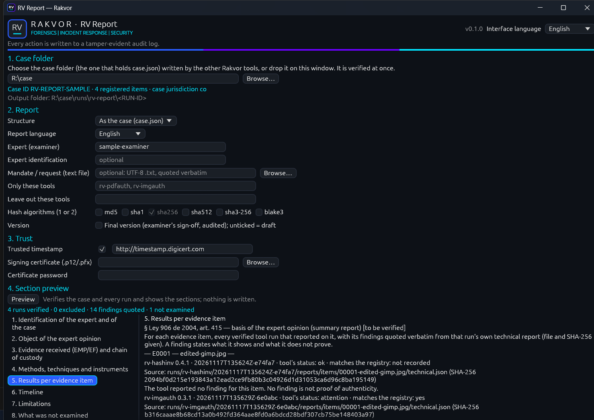
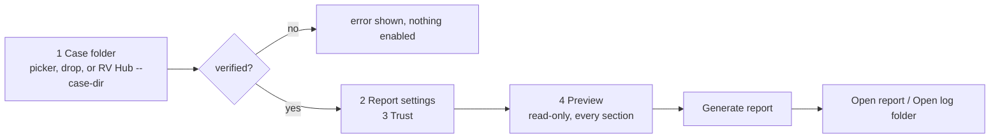

# Using the desktop app (Windows 10/11)

`rv-report-gui.exe` is the same core as the CLI with a window: choose a case folder, check the settings, preview
every section, generate the report.

## Workflow

## The window

| Area | Controls |
| --- | --- |
| Header | RV mark, descriptor, version, **interface language** (EN/ES/FR, applies at once) |
| 1. Case folder | path field, **Browse…** (Windows), drag and drop of the folder; shows case id, registered items, case jurisdiction and the output folder `<CASE>\runs\rv-report\<RUN-ID>` |
| 2. Report | structure (as the case / Colombia / France), report language (EN, ES, FR, all), expert name and identification, mandate file (checked at once: UTF-8, ≤ 64 KiB), tool filters, 1–2 hash algorithms, **Final version** |
| 3. Trust | trusted timestamp + TSA URL, signing certificate (.p12/.pfx) and password (memory only) |
| 4. Section preview | **Preview** verifies the case and every run without writing anything; counts (verified, excluded, quoted, not examined) and the section list with its text, from the report's own view model |
| Run | **Generate report** / Cancel, progress by runs, elapsed time, result counts, Open report, Open log folder, warnings (excluded runs) |

When started with a case folder (RV Hub's `--case-dir`, or a case folder dropped on the .exe) the preview is built
at once.

## What the GUI records

The log does not exist before Generate, so settings are kept with their time (`at_utc`) and written as the first
entries after `run_started` / `case_linked`:

`ui_case_dir_changed`, `ui_case_dir_from_launcher`, `ui_launch_argument_ignored`, `ui_jurisdiction_changed`,
`ui_language_changed`, `ui_interface_language_changed`, `ui_examiner_changed`, `ui_mandate_changed` (path and
SHA-256, never the text), `ui_tool_filter_changed`, `ui_final_changed`, `ui_hash_selection_changed`,
`ui_timestamp_changed`, `ui_signing_certificate_changed` (path only), `ui_preview_built` (counts),
`ui_start_clicked` (final settings). The password is never recorded. `environment.json` stores the GUI settings as
its command line.

## Same results as the command line

The GUI calls `run::run_assemble` exactly as `rv-report assemble` does; `state.rs` tests run the real core from GUI
settings and check the audit log ([src/gui/src/state.rs](../src/gui/src/state.rs)).
