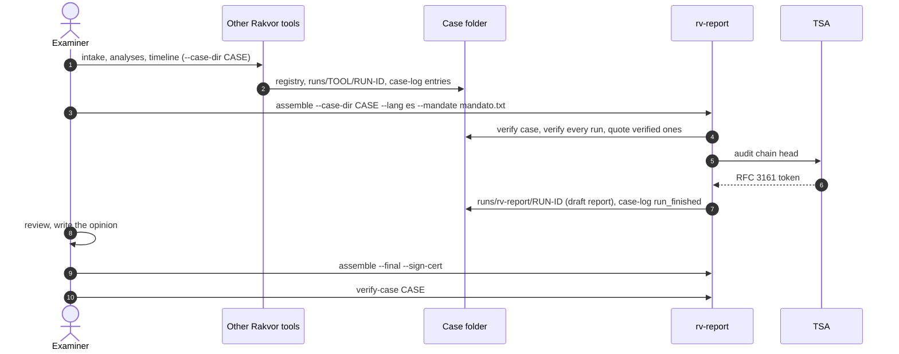
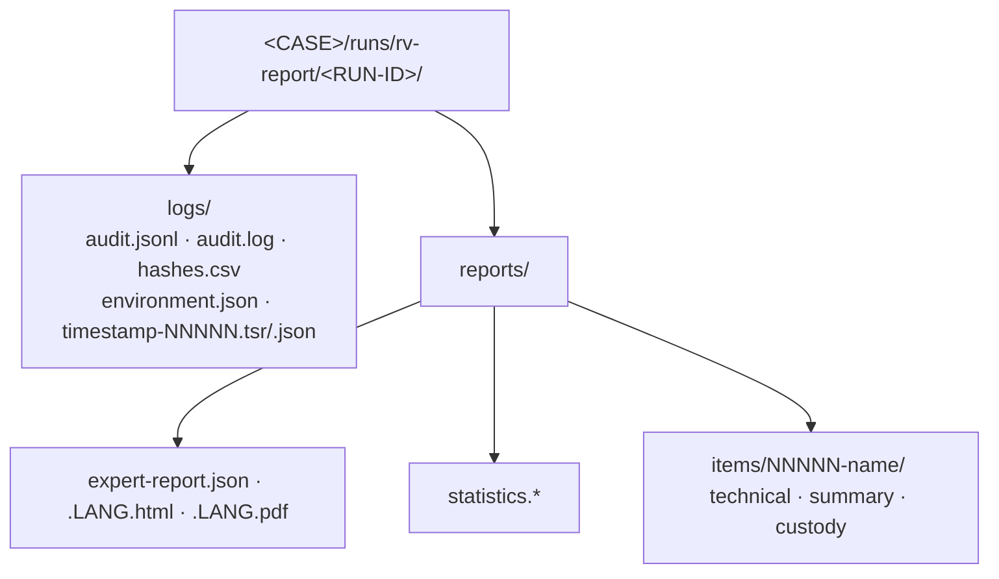

# Usage guide: from a case folder to a signed expert report

This is the end-to-end guide for an examiner. It walks through one case, explains every output, says how to read
each finding, and how to prove afterwards that nothing changed. Option lists are not repeated here:

- every command, option, default, example and exit code: [usage-cli.md](usage-cli.md) (generated from `--help`);
- the desktop app, window by window: [usage-gui.md](usage-gui.md);
- the case folder contract: [case-folder.md](case-folder.md);
- why each check works: [theory.md](theory.md); legal weight: [admissibility.md](admissibility.md);
- installing and verifying the tool: [installation.md](installation.md).



## 1. Before you start

| Check | Why | How |
| --- | --- | --- |
| Work on a **verified copy** (forensic image, write-blocked export), never the original media | The tool is read-only in software, not a write blocker | Imaging tool + write blocker; note model and serial |
| The installed tool is the genuine release | Court question: "how do you know what you ran?" | [installation.md](installation.md) steps 2–4 and 6 |
| Hash policy | MD5/SHA-1 alone are not collision-resistant | Always include `sha256` (or `sha512`): `--hash sha256,md5` when an older record uses MD5 |
| Clock | Audit times come from the workstation clock | Check Windows time sync before the run |
| Jurisdiction | Selects the custody form | `--jurisdiction co` (default) or `fr`; in a case folder it is fixed at creation |
| Timestamp | Online TSA by default | `--no-timestamp` offline, then `rv-report timestamp` later; `--tsa-url` for a qualified / ECD TSA |
| Examiner certificate | Signs every PDF report | `--sign-cert examiner.p12` ([signing](#7-signing-reports-with-the-examiner-certificate)) |
| One case, one folder | Every tool of the case links to the same registry and case log | Create the case folder on the case volume, e.g. `D:\cases\CASE-2026-014` |

## 2. Case walkthrough

The example case: `CASE-2026-014`, Colombian jurisdiction, examiner Ana Ruiz, a client export on `E:\export`
(the sample case reproduces this with synthetic files). Outputs below come from real runs; paths are shortened.

<!-- forge:domain -->
### 2.1 The tools' runs (intake, analyses, timeline)

RV Report quotes what the other tools recorded, so the case is first built with them, all on the same `--case-dir`
(their own usage guides give the details):

```powershell
rv-hashinv scan --case-dir D:\cases\CASE-2026-014 --case CASE-2026-014 --jurisdiction co -i E:\export -r --lang es
rv-pdfauth analyze --case-dir D:\cases\CASE-2026-014 -i E:\export\pdf --lang es
rv-imgauth analyze --case-dir D:\cases\CASE-2026-014 -i E:\export\images --lang es
rv-timeline build --case-dir D:\cases\CASE-2026-014 --lang es
```

Run every tool with the report's language (`--lang es` for a Colombian filing, `fr` for a French one): RV Report
quotes each tool's own wording and never translates it.

### 2.2 Assemble the draft

```powershell
rv-report assemble --case-dir D:\cases\CASE-2026-014 --lang es --actor "Ana Ruiz" `
    --examiner-id "TP 12345" --mandate D:\cases\CASE-2026-014\mandato.txt
```

Output on the sample case (`examples/sample/case`, `--lang es`, no mandate; paths shortened):

```text
DONE  run 20261118T114444Z-ad8a02
  case:      RV-REPORT-SAMPLE
  report:    <CASE>\runs\rv-report\20261118T114444Z-ad8a02\reports\expert-report.es.html (draft for the examiner's review)
  runs:      verified 4, excluded 0, skipped 1
  quoted:    14 findings  items: 4  elapsed: 1.2 s
  signals:   high 0, medium 0, low 1, info 3
  timestamp: off
  logs:      <CASE>\runs\rv-report\20261118T114444Z-ad8a02\logs
```

In order: the case log, `case.json` and the registry were verified, and `run_started` was appended; every run of
the case was verified (4) or skipped (1: the assembly itself, `self`); each verified run's findings (14) and
limitations were quoted verbatim; the latest RV Timeline run was summarised; E0003 (`notes/acta.txt`) was listed as
not examined (`ITEM_NOT_EXAMINED`, low); three runs wrote English only, so their wording appears marked `[EN]` in the
Spanish report (`TRANSLATION_UNAVAILABLE`, info). Exit code 0.

### 2.3 Review, then the final version

Read the draft section by section (the GUI preview shows the same text). Check the annex for excluded runs, re-run
tools where a language is missing, write the opinion and the declaration in your own document or on the printed
draft, then:

```powershell
rv-report assemble --case-dir D:\cases\CASE-2026-014 --lang es --final --sign-cert C:\certs\ana-ruiz.p12
```

`--final` only changes the banner and is recorded (`report_marked_final`); the signature comes from your
certificate. Every assembly is a new run folder; the earlier drafts stay in the case.
<!-- /forge:domain -->

### 2.3 Verify the whole case

```powershell
rv-report verify-case D:\cases\CASE-2026-014
```

```text
OK  case CASE-2026-014: 4 case-log entries, 3 registered items, 1 runs verified: D:\cases\CASE-2026-014
```

Every Rakvor tool has `verify-case` and they agree (a case written by the Rust build verifies with the Python
build and the reverse). It checks the case-log chain, `case.json`, the registry digest, every run's audit chain and
timestamp tokens, and the cross-links between the case log and each run ([theory.md B7](theory.md#b7-the-case-folder)).
Exit 0 = intact (warnings, such as a run still in progress, are printed), 3 = broken, 1 = not a case folder.
By default it does not re-hash the evidence; add `--rehash` to read every registered item that is still reachable
at its registered path and compare its digests with the registry (a path registered several times is compared with
its latest registration):

```text
rv-report verify-case D:\cases\CASE-2026-014 --rehash
OK  case CASE-2026-014: 4 case-log entries, 3 registered items, 1 runs verified: D:\cases\CASE-2026-014
    re-hashed 3 of 3 registered items: 3 match the registry
```

A file that differs is listed as `E0002 <path>: sha256 differs from the registry (registered …, now …)` and the
exit code is 3; a file not reachable from this workstation is a warning, not a failure.

### 2.4 The same from the desktop app

Start **RV Report**, fill **Case folder** in section 1 (and **Case ID** plus the custody form's jurisdiction for a
new case), add the evidence (files, folders, drag and drop) — or none, to re-examine every registered item — tick
one or two hash algorithms, set the report language and examiner in *3. Reports*, the timestamp and certificate in
*4. Trust*, then **Start review**. The output folder is derived from the case folder and locked; the result panel
lists every evidence id and its status. Every setting you change before starting is written to the run's audit log
(`ui_*` actions). The engine, outputs and findings are the same as the CLI's. Details:
[usage-gui.md](usage-gui.md).

### Starting from RV Hub: `--case-dir` and `describe --json`

RV Hub (the Rakvor launcher) finds the installed tools, opens them on a case folder and suggests which one fits a
file. It relies on two entry points of RV Report:

- **`rv-report-gui.exe --case-dir <CASE> [FILES...]`** starts the desktop app with **Case folder** already filled
  (`--case-dir=<CASE>` also works). Other arguments are pre-loaded as evidence, as when files are dropped on the
  icon. The preset is written to the run's audit log as `ui_case_dir_from_launcher` (path and `at_utc`) followed by
  `ui_case_dir_changed`. `--case-dir` without a folder is ignored: the window says so and the audit log records
  `ui_launch_argument_ignored`.
- **`rv-report describe --json`** prints one JSON object (sorted keys) that RV Hub reads; it is hidden from
  `rv-report --help` but listed in [usage-cli.md](usage-cli.md). It reads and writes nothing. Schema:
  [`schemas/describe.schema.json`](../schemas/describe.schema.json) (`rakvor.describe/1`, identical in every Rakvor
  tool).

| Field | Meaning |
| --- | --- |
| `schema` | `rakvor.describe/1` |
| `tool`, `title`, `version` | `rv-report`, `RV Report`, the product version (`version.txt`) |
| `role` | `analysis` (reads the case folder; never writes the registry) |
| `main_verb` | `assemble`: the command that does the main work |
| `accepts` | `extensions` (lower case, no dot) and content `signatures` (`format` + `match`: hex bytes at an offset); `"*"` = any file |
| `case_formats`, `log_formats` | `rakvor.case/1`; `rakvor.audit/1` = `logs/audit.jsonl` |
| `cli_exe`, `gui_exe` | `rv-report.exe`, `rv-report-gui.exe` |
| `exit_codes` | The meaning of 0, 1, 2, 3 and 130 (table in section 9) |

```powershell
rv-report describe --json
```

## 3. Reading the outputs



| Output | For | What to use it for |
| --- | --- | --- |
| `expert-report.<lang>.html/.pdf` | Examiner, court | The report, section by section ([reports.md](reports.md)); draft until `--final` |
| `expert-report.json` | Scripts, opposing expert | The model: every quotation with its source file, SHA-256 and pointer |
| `statistics.*` | Examiner | RV Report's signals, items, timestamp, audit head |
| `items/*/technical.*` | Examiner | Per registered item: RV Report's signals and the quoted results |
| `items/*/custody.*` | Custody record | Form in the case's jurisdiction + English, blank transfer rows |
| `audit.jsonl` / `audit.log` | Verification | Every action, hash-chained (runs verified, excluded, quoted) |
| `hashes.csv` | Verification | Every file the report was built from, with the run's digests |
| `environment.json` | Reproducibility | Tool, compiler, dependencies, OS, host, user, command line (or GUI settings) |

**Exit code 3** means at least one run was excluded or a medium/high RV Report signal: review the annex before
relying on the report.

## 4. Interpreting each finding

Severity in brackets. "Check next" is what an examiner should do before relying on the finding; "do not
conclude" is the overreach to avoid in a report. The exact wording printed in reports is in `i18n/en.json` (es, fr).

<!-- forge:domain -->
| Code | Check next | Do not conclude |
| --- | --- | --- |
| `RUN_EXCLUDED` (medium) | The reason in the annex (`chain_broken`, `digest_mismatch`, `not_finished`, …); `verify-log` on that run; repeat the run on a verified copy | That the evidence or the examiner did anything wrong |
| `REGISTRY_MISMATCH_REPORTED` (high) | The quoting run's `EVIDENCE_HASH_MISMATCH_WITH_CASE` finding; `verify-case --rehash`; storage and transfers since intake | Which copy is the original, or that anyone altered it |
| `ITEM_NOT_EXAMINED` (low) | Whether the mandate covers the item; run the right analysis tool | That the item is suspicious |
| `TIMELINE_PREDATES_RUNS` (low) | Rebuild the timeline with RV Timeline, then assemble again | That the timeline is wrong |
| `TRANSLATION_UNAVAILABLE` (info) | Re-run that tool with the report's `--lang` | Any change of result |
| `UNKNOWN_TOOL` / `TIMELINE_ABSENT` / `JURISDICTION_DIFFERS_FROM_CASE` (info) | That tool's documentation / whether a timeline is needed / the structure you want | Anything about the evidence |

Quoted findings keep the meaning their own tool gives them; see that tool's usage guide.
<!-- /forge:domain -->


## 5. Machine-readable progress

```powershell
rv-report assemble --case-dir D:\cases\CASE-2026-014 --progress jsonl > events.jsonl
```

One JSON event per line on stdout: `run_started` (total = runs found), `item_started` / `item_finished` per run
(status `verified`, `excluded`, `skipped`), `progress`, `report_written`, `timestamp`, `run_finished`. Exclusions
are repeated on stderr. RV Report always works inside a case folder; `--out` is accepted and ignored.

## 6. Timestamps

By default each run asks the TSA (`http://timestamp.digicert.com`, change with `--tsa-url`) to sign the audit
chain head just before the statistics report is written. The token covers every evidence digest, finding and
item-report digest recorded before it, not the statistics report and `run_finished` written after it
([theory.md B8](theory.md#b8-rfc-3161-trusted-timestamp)).

| Situation | What happens | What to do |
| --- | --- | --- |
| TSA reachable | `timestamp_obtained`; files `timestamp-NNNNN.tsr` and `.json` in the log folder; statistics report shows the time | Verify with OpenSSL (below) |
| Offline | `timestamp_pending`; the run completes; warning on the statistics report and the console | Later, online: `rv-report timestamp <log folder>` |
| `--no-timestamp` / `RV_NO_TIMESTAMP=1` / GUI unticked | No request | Use `rv-report timestamp` later if needed |
| Broken chain | `rv-report timestamp` refuses (exit 3): no timestamp is added to a broken log | Investigate; do not repair |

`verify-log` checks the token's digest, that it covers the logged head and the TSA's CMS signature
(`TSA signature valid (signer: …)`). The TSA certificate chain is validated only with `--tsa-ca`:

```bash
rv-report verify-log <log folder> --tsa-ca <TSA roots.pem>
# → … TSA signature valid (signer: …); chain validated to … (revocation not checked)
# without --tsa-ca: … chain not checked (pass --tsa-ca <CA bundle> to validate it)
```

An unreadable bundle exits 1; a signature or chain failure exits 3; a token the log records whose `.tsr` or
`.json` is missing exits 3 too. Revocation is never checked (gap G18). As an independent **signature and chain**
check, use OpenSSL (Git for Windows ships `openssl.exe`); it does not check revocation either (no CRL is supplied
and OpenSSL does not query OCSP):

```bash
cd <log folder>
N=00022                                                   # from the file name timestamp-00022.tsr
H=$(python -c "import json;print(json.load(open('timestamp-$N.json'))['head'])")
openssl ts -reply -in timestamp-$N.tsr -text              # genTime, policy OID, TSA name, serial, nonce, accuracy
openssl ts -reply -in timestamp-$N.tsr -token_out -out token.der
openssl pkcs7 -inform DER -in token.der -print_certs > tsa-certs.pem   # certificates sent by the TSA
openssl ts -verify -digest "$H" -in timestamp-$N.tsr -CAfile <TSA root.pem> -untrusted tsa-certs.pem
# → "Verification: OK"  (signature and chain only, not revocation)
```

Establish the TSA certificate's revocation status separately, from CRL/OCSP evidence that covers genTime (a CRL
issued after genTime by the TSA's CA, or an OCSP response archived at stamping time), e.g.
`openssl verify -crl_check -CRLfile tsa-ca.crl -CAfile <TSA root.pem> -untrusted tsa-certs.pem -attime <genTime-epoch> tsa.pem`,
or `rv-certcheck analyze --crl … --ocsp …`. Get the TSA root certificate from the TSA's own repository, not from the token. Record the output in the case file:
it is the evidence that the time is genuine.

> **CRL dates and `-attime`.** OpenSSL applies `-attime` to the CRL as well, so `openssl verify -crl_check -attime <genTime-epoch>` only works with a CRL whose `thisUpdate`–`nextUpdate` interval contains genTime; a CRL issued after genTime fails with "CRL is not yet valid". To use a later CRL as evidence, check its signature (`openssl crl -in tsa-ca.crl -CAfile <TSA root.pem> -noout -verify`), then look up the TSA certificate's serial in it (`openssl crl -in tsa-ca.crl -noout -text`): absent, or listed with a revocation date after genTime, means not revoked at genTime. A CA may drop expired certificates from its CRLs, so for a TSA certificate that has since expired an absent serial is not conclusive: use a CRL from before its expiry, or an OCSP response archived at stamping time.

## 7. Signing reports with the examiner certificate

`--sign-cert <file.p12|.pfx>` signs **every PDF report** (statistics, technical, summary, custody) with your own
certificate (RSA keys only). The password is read from the environment variable named by `--sign-pass-env`
(default `RV_SIGN_PASSWORD`) or asked for on the terminal (nothing is echoed while you type). It is never logged;
the log records `signing_certificate_loaded` with the subject and the certificate's SHA-256, and every report prints
both (`Signed by <subject> (certificate SHA-256 <fingerprint>)`). A wrong password stops the run (`run_failed`, exit 1) before any evidence is read. In the GUI: *4. Trust →
Signing certificate* and *Certificate password* (kept in memory only).

```powershell
$s = Read-Host "Certificate password" -AsSecureString
$env:RV_SIGN_PASSWORD = [Runtime.InteropServices.Marshal]::PtrToStringBSTR(
    [Runtime.InteropServices.Marshal]::SecureStringToBSTR($s))
rv-report assemble --case-dir D:\cases\CASE-2026-014 --lang es --sign-cert C:\certs\ana-ruiz.p12
Remove-Item Env:RV_SIGN_PASSWORD
(Get-PfxCertificate C:\certs\ana-ruiz.p12).GetCertHashString("SHA256")   # publish this fingerprint
```

Check a signed report with Adobe Acrobat/Reader (Signature panel) or pyHanko:
`pyhanko sign validate --pretty-print --trust <your CA or certificate .pem> technical.en.pdf` (expected: intact,
coverage of the entire file). HTML and JSON reports are not signed; their digests are in the timestamped audit
chain. The legal weight of this signature depends on the certificate ([admissibility.md](admissibility.md) G3).

## 8. Verifying a run

Anyone — you, a colleague, an opposing expert — can check a run with its log folder, its report folder and the
evidence copy:

```powershell
rv-report verify-log D:\cases\CASE-2026-014\runs\rv-report\20261021T154339Z-6e298b\logs
# OK  25 entries, chain intact: …\audit.jsonl
#     timestamp 2026-10-21T15:43:40Z by http://127.0.0.1:33481/tsr covers entry #22
#     truncation: the final entry #25 is anchored by the case log (run_finished)
#     outputs: 38 verified of 38 recorded (md5, sha256)
#     not re-hashed: logs/timestamp-00022.tsr (RFC 3161 token: checked by the timestamp verification)
```

The last line says what vouches for the length of the log. A standalone run with a timestamp prints
`truncation: entries up to #22 are anchored by the RFC 3161 timestamp (timestamp-00022.json); 3 entries after it
(timestamp_obtained, statistics_report_written, run_finished) cannot be proven complete`; a standalone run without
a timestamp prints `truncation not detectable without a timestamp or case record`. A log shorter than its
timestamp or case record is `BROKEN` (`truncated: …`, exit 3).

The `outputs:` line is the re-hash of every file the log says the run wrote (each item's reports, the statistics
reports, `hashes.csv`, `environment.json`), with every algorithm the log recorded; the latest entry for a file
wins. A file edited, deleted or replaced after the run makes the run `BROKEN` (exit 3) and is named:

```text
BROKEN  …udit.jsonl
  - output reports/statistics.json: sha256 differs from audit entry #37 (recorded e8ed…, now 73cb…): edited or replaced after the run
  - output reports/items/00002-photo.jpg/technical.en.pdf: missing (recorded by audit entry #31): deleted or moved after the run
    outputs: 36 verified of 38 recorded (sha256), 1 missing, 1 changed
```

A recorded path that is absolute, contains `..`, or resolves outside the run folder through a symlink or junction is
rejected and never read. The timestamp token is listed as `not re-hashed` because the timestamp check above
already verifies it. Files the run did not record (anything added to the folder later) are not checked.

| Step | Command | Proves |
| --- | --- | --- |
| 1 | `rv-report verify-log <log>` (exit 0 intact, 3 broken or truncated) | No entry edited, deleted or reordered; timestamp token matches the head it covers; the log still reaches the entry its timestamp covers and, in a case folder, the final entry recorded in the case log (the `truncation:` line names the anchor) |
| 2 | `python tests/verify_chain.py <log>` (source tree) | Same, with an independent implementation; also re-hashes the evidence listed in `hashes.csv` and every output the audit log records |
| 3 | OpenSSL ([Timestamps](#6-timestamps)) | The TSA really signed that head at that time |
| 4 | Step 1 (`outputs:` line); script below for an independent check | Every report file, `environment.json` and `hashes.csv` still has the digest recorded in the log |
| 5 | `rv-report verify-case <CASE> --rehash` | The run is the one the case log announced, complete up to its recorded final entry, with every recorded output unchanged; the reachable evidence still matches the registry |
| 6 | `python tests/validate_reports.py <CASE or report folder>` | Every JSON report, `case.json` and `registry.json` match their schemas |

Step 4 is built into `verify-log` and `verify-case`. To check it with code you can read in one screen (an
independent implementation, e.g. for an opposing expert), re-hash every file the run recorded:

```bash
python - "<log folder>" "<report folder>" <<'EOF'
import hashlib, json, pathlib, sys
log, rep = pathlib.Path(sys.argv[1]), pathlib.Path(sys.argv[2])
def digest(p, algo):
    h = hashlib.new({"sha3-256": "sha3_256"}.get(algo, algo)); h.update(p.read_bytes()); return h.hexdigest()
checked = bad = 0
for line in (log / "audit.jsonl").open(encoding="utf-8"):
    e = json.loads(line); a, d = e["action"], e["details"]
    if a == "item_reports_written":
        files = {rep / d["folder"] / k: v for k, v in d["files"].items()}
    elif a == "statistics_report_written":
        files = {rep / k: v for k, v in d["files"].items()}
    elif a in ("environment_recorded", "hash_register_written"):
        files = {log / e["item"]: d}
    else:
        continue
    for p, digests in files.items():
        algo = next(x for x in ("sha256", "sha512", "sha3-256", "sha1", "md5") if x in digests)
        checked += 1
        got = digest(p, algo) if p.is_file() else "missing"
        if got != digests[algo]:
            bad += 1; print("MISMATCH", p, algo, got)
print(f"{checked} files checked, {bad} mismatches"); sys.exit(3 if bad else 0)
EOF
```

On the sample run (3 items, one language) this checks 38 files; appending one byte to `statistics.json` gives
`MISMATCH … statistics.json` and exit code 3. A single file in PowerShell: `(Get-FileHash <file> -Algorithm
SHA256).Hash.ToLower()` and search the value in `audit.jsonl`.

## 9. Troubleshooting

### Exit codes

| Command | 0 | 1 | 2 | 3 | 130 |
| --- | --- | --- | --- | --- | --- |
| `assemble` | report assembled, every run verified, no medium/high signal | runtime error (case log locked, output not writable, wrong certificate password) | usage error (unknown option, three algorithms, unknown language, bad tool name, mandate file, not a case folder, another case) | a run excluded or a medium/high signal; or the case folder fails verification (nothing written) | cancelled (Ctrl+C) |
| `verify-log` | intact | log unreadable | — | broken chain, token mismatch, or truncated (shorter than its timestamp or case record) | — |
| `verify-case` | case intact (warnings printed) | not a case folder (no `case.json`) | — | at least one check failed (with `--rehash`: an evidence file differs from the registry) | — |
| `timestamp` | obtained and logged | TSA unreachable (nothing changed) | — | log missing, broken or unreadable (nothing added) | — |
| `self-test` | all pass | a failure: do not use the build | — | — | — |
| `describe` | description printed | — | usage error (unknown option) | — | — |

### Messages

<!-- forge:domain -->
| Message | Fix |
| --- | --- |
| `… is not a case folder (no case.json)` | Point `--case-dir` at the folder that holds `case.json` |
| `mandate file … is not UTF-8 text` / `… at most 65536 are accepted` | Save the mandate as UTF-8 text; quote the object, not the whole file |
| `--include-tool '…': a Rakvor tool name such as rv-pdfauth` | Use the tool names of the case's `runs/` folders |
| `warning: run excluded (not verified, not quoted): runs/…` | See `RUN_EXCLUDED` above |
<!-- /forge:domain -->

| Message | Fix |
| --- | --- |
| `… is not a case folder yet: give --case ID (and --jurisdiction) to create it` | First run in a new case folder: add `--case` |
| `the case folder … belongs to case X, not Y` | Wrong folder or wrong `--case`; leave `--case` out after creation |
| `evidence id(s) not in the case registry: E0042` | Check `evidence\registry.csv`; ids are `E` + number (`e7` = `E0007`) |
| `refusing to extend a broken case (…)` / `the case folder … fails verification` | Run `verify-case`; investigate what changed; **do not repair** a case log by hand — open a new case folder and document why |
| `the case log is locked by <tool> run <id> (since …)` | Another tool is writing; wait and run again |
| `stale case lock … held by … for more than 10 minutes` | Make sure no Rakvor tool is working on the case, then delete `case-log.lock` by hand (never automatic) and note it in the case file |
| `cannot load signing certificate …: wrong password or unsupported file` | Check `RV_SIGN_PASSWORD`; the file must be a `.p12`/`.pfx` with a private key |
| `only RSA signing certificates are supported` | Use an RSA certificate (ECDSA is not supported for report signing) |
| `warning: timestamp pending (…)` | See [Timestamps](#6-timestamps) |
| `refusing to append to a broken audit log` (`timestamp`) | The log was edited; investigate with `verify-log`; do not repair |
| `no audit log at …: nothing to timestamp` (`timestamp`) | Point at the run's `logs\<RUN-ID>` folder (or its `audit.jsonl`) |
| `truncated: …` (`verify-log`) | Entries were removed from the end of the log after the timestamp or the case record was made; investigate, do not repair |
