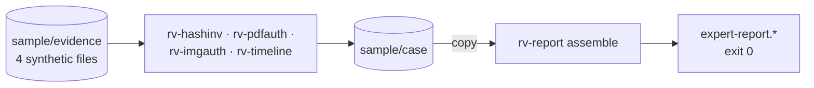

# Examples

`sample/case/` is a small Rakvor case folder written by the **released** Rakvor tools on synthetic evidence
(`sample/evidence/`); `rv-report assemble` runs on a copy of it. Details and how it was built:
[sample/README.md](sample/README.md).



| Evidence | Examined by | Expected in the report |
| --- | --- | --- |
| `images/edited-gimp.jpg` (E0001) | rv-imgauth (en) | its findings quoted (EXIF editor, inconsistent dates, XMP history, …), marked `[EN]` in es/fr reports |
| `images/photo.webp` (E0002) | rv-imgauth (en) | `WEBP_FLAGS_MISMATCH`, `PIXELS_NOT_DECODED`, … quoted |
| `notes/acta.txt` (E0003) | intake only | listed under *what was not examined* (`ITEM_NOT_EXAMINED`) |
| `pdf/edited-incremental.pdf` (E0004) | rv-pdfauth (en, es, fr) | its findings quoted in each language |

Expected summary (`--lang all`): runs verified 4, excluded 0, skipped 1 (the assembly itself), 14 findings quoted,
signals high 0, medium 0, low 1, info 6, exit code 0.

```bash
sh examples/sample/run.sh target/release/rv-report          # Linux / Git Bash
.\examples\sample\run.ps1 -Bin .\target\release\rv-report.exe   # Windows
```

Both scripts work on a copy in `examples/sample/out/`, check that `expert-report.json` is listed with its SHA-256
in the audit log, and run `verify-log` and `verify-case`.
