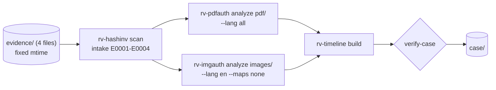

# Sample case

`case/` is a real Rakvor case folder (`rakvor.case/1`, about 3 MB) written by `tests/make_sample_case.sh` with
released tool builds on the synthetic files of `evidence/`. Versions and SHA-256 of the executables:
`tool-versions.json`. Nothing here is edited by hand; every output each run recorded is kept, so `verify-case`
passes and RV Report verifies all four runs.



| File | From | Why it is here |
| --- | --- | --- |
| `pdf/edited-incremental.pdf` | rv-pdfauth sample | multi-revision PDF: several findings, wording in en/es/fr |
| `images/edited-gimp.jpg` | rv-imgauth sample | editor traces: findings in English only (shows the `[EN]` marking) |
| `images/photo.webp` | rv-imgauth sample | small WebP with structural findings |
| `notes/acta.txt` | rv-hashinv sample | registered but examined by no analysis tool |

All files are synthetic (generated by the tools' own sample scripts); the names in them are fictitious. The tools ran
from a `subst` drive (`R:\`) with a neutral host and user name (`RV-SAMPLE-HOST`, `sample-examiner`), no timestamp
and no signing certificate. Options: `--hash sha256,md5 --actor "Sample Examiner"`.

**Tampered copies** are not committed: `src/cli/tests/cli.rs` writes them at test time — an edited rv-imgauth
`technical.json` (`digest_mismatch`), an edited rv-pdfauth audit entry (`chain_broken`), RV Timeline's
`run_finished` removed from the case log (`not_finished`) — and checks that each run is excluded and never quoted.

Rebuild (needs release builds of rv-hashinv, rv-pdfauth, rv-imgauth and rv-timeline):

```bash
RV_TIMELINE_EXE=<path to rv-timeline> tests/make_sample_case.sh <folder holding the tool repositories>
```

`expected_hashes.csv` lists the evidence digests computed independently (Python `hashlib` and `blake3`).
